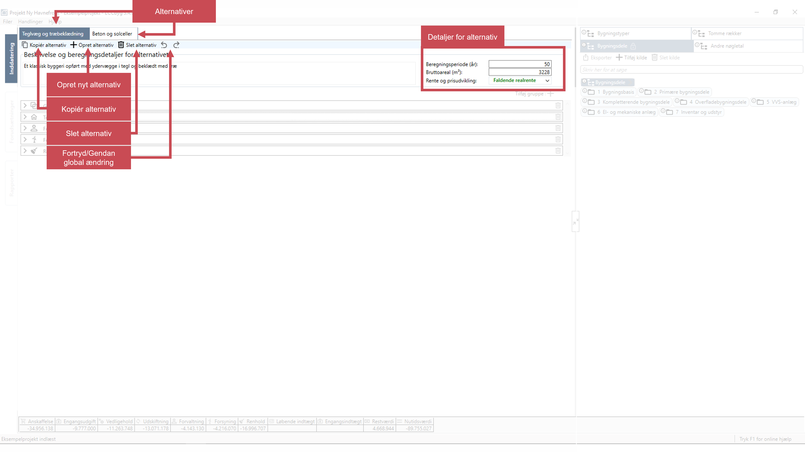

LCCbyg gør det muligt at arbejde med flere alternativer i den samme beregning. Alternativer oprettes og redigeres under 'Inddatering'. LCCbyg vil altid rumme mindst ét alternativ.  Du kan [oprette, kopierer og slette alternativer]('#opretalternativ). Du bør tilpasse [detaljer for alternativer](#detaljeralternativ) for alle alternativer i din beregning. 

Figur 1: Muligheder for at tilføje og tilpasse alternativer. 

### Opret, kopiere og slette alternativer

Et nyt alternativ kan oprettes ved at trykke på 'Opret alternativ' i værktøjslinjen. Du kan også kopiere et alternativ ved at trykke på 'Kopiér alternativ'. Dette er en fordel, hvis du kun vil foretage få ændringer imellem to alternativer. Fanen med grå (se alternativet navngivet ’Teglvæg og træbeklædning’ i (se figur 1) markerer hvilket alternativ du arbejder i. Et alternativ kan slettes ved at trykke på 'Slet alternativ' i værktøjslinjen for det pågældende alternativ. Sletning af et alternativ kan fortrydes ved at trykke på 'Fortryd global ændring' i 'Handlinger' under [Hovedmenulinjen](https://lccbyg.dk/help/32/docs/interface/help/).

Rækkefølgen af alternativerne kan ændres ved at trække og slippe alternativerne.

Alternativer kan frit navngives ved at stille sig i tekstfeltet for navne og skrive et nyt navn.

### Detaljer for alternativer

For hvert alternativ inddateres beregningsperiode, bruttoareal samt rente- og prisudvikling. Disse felter er nødvendige for at beregningen fungerer. Bemærk at beregningsperioden som standard er 50 år, når et nyt projekt åbnes. Tilsvarende vil standardprojekter have faldende realrente, mens DGNB-projekterne benytter ’fast nominel rente’.

#### Beregningsperiode

LCCbyg beregner de årlige omkostninger ud fra den valgte beregningsperiode. Dette indsættes i feltet ‘Beregningsperiode’, hvor hele år angives. Kalkulations- eller beregningsperioden er som udgangspunkt sat til 50 år, men kan ændres til en værdi mellem 0 og 120 år, hvis det ønskes.

Hvis beregningsperioden sættes til 0 år, vil applikationen kun beregne anskaffelsesomkostningerne. 

#### Bruttoareal

Feltet 'Bruttoareal' indtastes etagearealet iht. Bygningsreglementet, der måles til ydersiden af ydervægge. 

#### Rente og prisudvikling

Der vil altid være et forudindstillet rente- og prisudviklingssæt valgt i skabelonerne. Det er muligt at ændre rente og prisudvikling ved 'Almindelig grænseflade'. Under de enkelte omkostningstyper vil der være en drop down-menu, hvor du skal vælge den relevante rente og prisudvikling (læs mere herom under Forudsætninger).

Du kan vælge blandt de følgende fire rente- og prisudviklingssæt:

- Faldende realrente
- Fast nominel rente
- Fast realrente
- Nuludvikling
