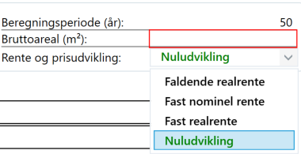

#### Beregningsperiode

LCCbyg beregner de årlige omkostninger ud fra den valgte beregningsperiode. Dette indsættes i feltet ‘Beregningsperiode’, hvor hele år angives. Kalkulations- eller beregningsperioden er som udgangspunkt sat til 50 år, men kan ændres til en værdi mellem 0 og 120 år, hvis det ønskes. En beregningsperiode på >25 år bør vælges, da mange bygningsdele har en levetid på >25 år.

En beregningsperiode på mindre end 25 år vil dermed ikke vise, hvilken effekt udskiftning eller genopretning af bygningsdele vil medføre for den samlede nutidsværdi. Hvis beregningsperioden sættes til 0 år, vil applikationen kun beregne anskaffelsesomkostningerne. 

#### Bruttoareal

_Bemærk: Der kan ses bort fra dette felt ved visning i 'Enkel grænseflade'._

Feltet 'Bruttoareal' indtastes etagearealet iht. Bygningsreglementet, der måles til ydersiden af ydervægge. Etagearealet beregnes ved en sammenlægning af bruttoarealerne af samtlige etager, herunder kældre og udnyttelige tagetager, samt altanlukninger, udestuer, forbindelsesgange og lignende.

#### Rente og prisudvikling

_Bemærk: Rente og prisudvikling er for skabeloner vist i ‘Enkel grænseflade’ sat til 'Fast realrente'. Herved undgår du som bruger at tage stilling til beregningsforudsætningerne._ 

Som udgangspunkt er 'Rente og prisudvikling' defineret på forhånd af applikationen til at være lig med 'Fast realrente'. Det er muligt at ændre rente og prisudvikling ved 'Almindelig grænseflade'. Under de enkelte omkostningstyper vil der være en dropdown-menu, hvor du skal vælge den relevante rente og prisudvikling [(læs mere herom under Forudsætninger)](http://lccbyg.dk/help/36/docs/interface/prerequisites/). Du kan vælge blandt de følgende fire rente- og prisudviklingssæt:

- Faldende realrente
- Fast nominel rente
- Fast realrente
- Nuludvikling

Figur 1. Angivelse af beregningsperiode, bruttoareal samt rent og prisudvikling (Almindelig grænseflade).
