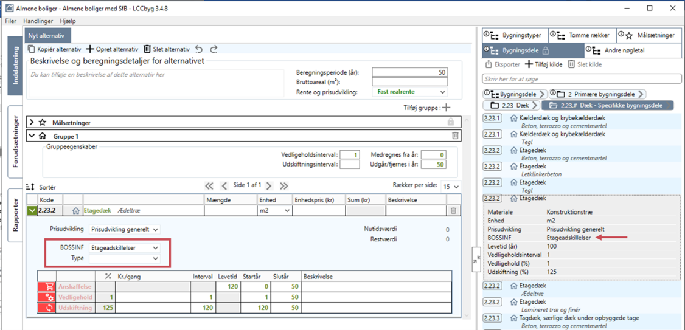

BOSSINF STB er et system, der benyttes til administration af kommunernes anmodninger om officiel støtte i henhold til lovgivningen om støttet boligbyggeri, herunder almene boliger.

Skabelonen ’Almene boliger med SfB’ er en udvidet version af standardprojektet, hvor bygningsdele er opdelt efter SfB med mulighed for opmærkning efter BOSSINF. Figur 1 viser, at BOSSINF-koderne findes på rækkeniveau under nøgletallene i programmets højre side samt når rækken er trukket over i inddateringen i programmets venstre side.

\[caption id="attachment\_2546" align="alignnone" width="1126"\] Figur 1: Opmærkning af rækkedetaljer via BOSSINF\[/caption\]

Når rækken er inddateret, kan BOSSINF-opmærkningen ændres såfremt der er behov for dette. Dette gøres ved at klikke på drop down-menuen og vælge den nye opmærkning. Tabellen nedenfor indeholder en oversigt over de mulige opmærkninger i BOSSINF. I LCCbyg er de sorteret under seks BOSSINF-grupper, der i overordnede termer beskriver BOSSINF-kodens natur.

|     |     |
| --- | --- |
| **BOSSINF gruppe** | **BOSSINF-kode** |
| Grundudgifter | Grundudgifter i alt |
| Håndværkerudgifter | Tag  Ydervægge  Døre og vinduer  Altaner og altangange  Etageadskillelser  Fundament og kælder  Vådrum  Afløb i jord og bygninger  Tekniske anlæg  Øvrige bygningsdele  Arealudvidelse |
| Andre håndværkerudgifter | Udgifter til byggeplads  Bygherreleverance  Særlige vinterforanstaltninger  Mindre reguleringer og uforudseelige udgifter |
| Omkostninger | Teknisk rådgivning  Byggesagshonorar  Bestyrelsesudgifter  Genhusningsudgifter  Byggeadministration  Stiftelsesprovision  Byggelånsrenter  Øvrige finansielle udgifter |
| Gebyrer | Bidrag til Byggeskadefonden  Byggetilladelse og andre gebyrer |
| Driftsresultat i byggeperioden | Driftsudgifter i byggeperioden  Lejeindtægter i byggeperioden |

Udover BOSSINF-koder er der i skabelonen ’Almene boliger med SfB’ mulighed for opmærkning via ’Typer’. ’Typer’ benyttes til at beskrive hvad omkostningens knytter sig til af aktiviteter inden for projektet. Der kan vælges imellem følgende typer:

- Grundudgifter
- Opretning
- Ombygning
- Miljøarbejder
- Nedrivning
- Infrastruktur
- Modernisering
- Nedslidning
