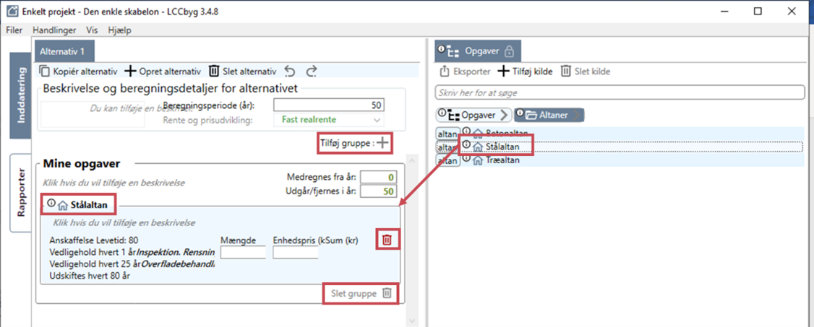
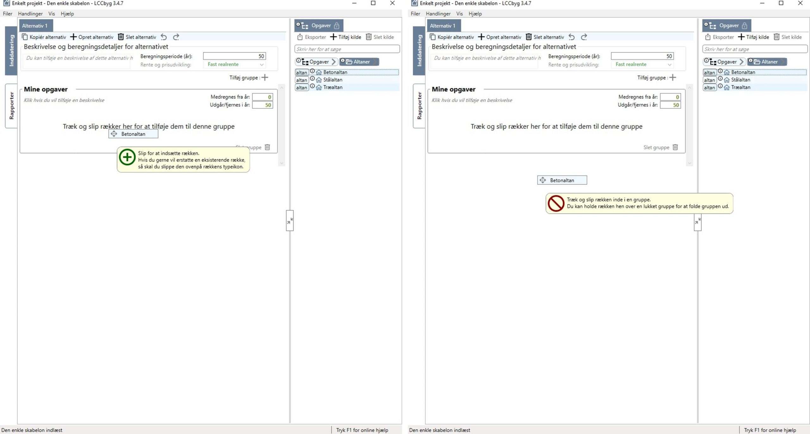
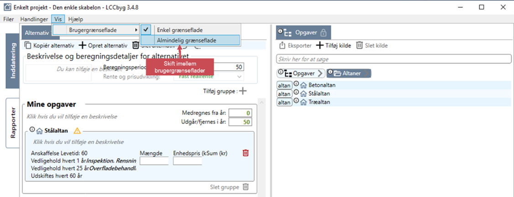

I 'Inddatering' kan du inddatere data og sammensætte din beregning med henblik på at foretage en totaløkonomisk analyse af byggeriet og/eller af forskellige alternativer. Du kan vælge at foretage en samlet beregning for et helt byggeri, hvis det eksempelvis drejer sig om totalrenovering. Du kan også vælge at basere din beregning på enkelte bygningsdele, hvis blot enkelte bygningsdele ønskes renoveret. Skabeloner fra 'Den enkle skabelon' er skræddersyet til alle brugere og indeholder enhedspriser i kontoplanen. Her kan der vælges mellem skabelonen 'Renoveringsopgaver' og/eller det underliggende eksempel, som kan redigeres.

Under 'Inddatering' kan bygningselementer trækkes over i 'Mine opgaver', hvor de kan inddeles i grupper under forskellige alternativer.

### Inddatering af rækkedetaljer

Du kan tilføje rækker ved at åbne en gruppe i programmets højreside under 'opgaver' og trække den fra højre felt ['Kontoplaner'](https://lccbyg.dk/help/34/docs/interface/acountplans/) og slippe dem i den ønskede gruppe  (se figur 2 og figur 3). Se ['Kontoplaner'](https://lccbyg.dk/help/34/docs/interface/acountplans/) for flere informationer om navigering i nøgletal.

\[caption id="attachment\_2550" align="alignnone" width="1126"\] Figur 1: Inddatering i den enkle skabelon. Klik på en gruppe for at åbne den. Vælg en række, træk og slip under den ønskede gruppe.\[/caption\]

#### Landingszone

LCCbyg version 3.4 fortæller dig, om du kan slippe rækken på et givent sted. Figur 3 viser træk og slip af rækkedetaljer inden for gruppen tillades. Modsat kan træk og slip uden for en gruppe ikke vil lade sig gøre.

Figur 3: Brugerinterface fortæller dig, hvor du kan indsætte rækken.

 

### Skiftning af visningsformat

I nogle skabelonerne vil der være en ‘Vis’ fane øverst i hovedmenulinjen. Her er der mulighed for at skifte mellem flere visninger. I ‘Den enkle skabelon’ kan der vælges mellem: ‘Enkel grænseflade’ og ‘Almindelig grænseflade’. Begge grænseflader gemmer i samme filformat, og derfor er det muligt at åbne dem i begge visningstyper. Figur 4 viser, hvordan der kan skiftes imellem grænseflader i den enkle skabelon.

\[caption id="attachment\_2551" align="alignnone" width="1126"\] Figur 4: Skiftning af visning af grænseflade. Den gule advarselstrekant/disclaimer fortæller at der er foretaget ændringer i 'Almindelig grænseflade'.\[/caption\]

Den enkle grænseflade er et simpelt visningsformat, hvor der blot skal vælges bygningskomponenter/rækker fra kontoplanen og indtastes mængderne af disse. Er der undervejs behov for at kunne justere i detaljerne af rækkerne, kan dette gøres ved at skifte til ’Almindelig grænseflade’ (Læs mere under Hovedmenulinjen – Vis).

Hvis der er ændret i nøgletallene i ’Almindelig grænseflade’ og visningsformatet ændres til ’Enkel grænseflade, vil der fremkomme en gul advarselstrekant/disclaimer, der vil minde om, at der er foretaget nogle ændringer i ’Almindelig grænseflade’, der ikke er adgang til i ’Enkel grænseflade’.

Bemærk, at redigerede værdier fremkommer med sort skrift, mens standardværdier fremkommer med grøn skrift.
