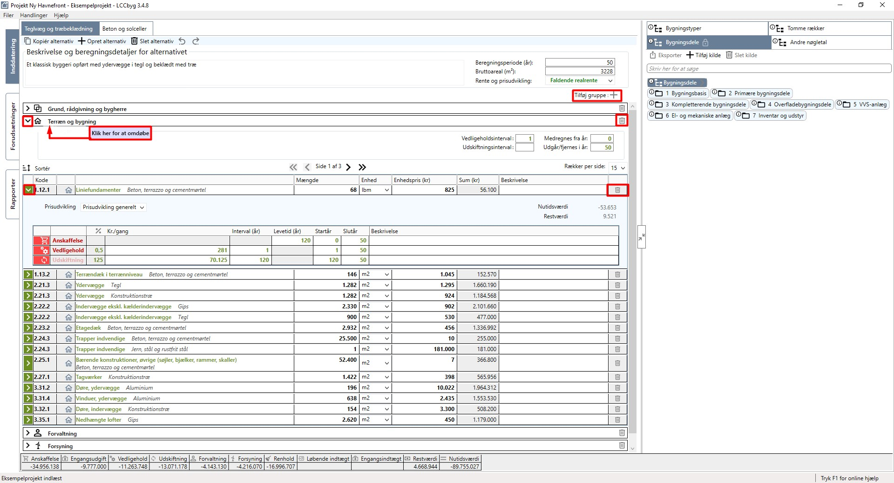
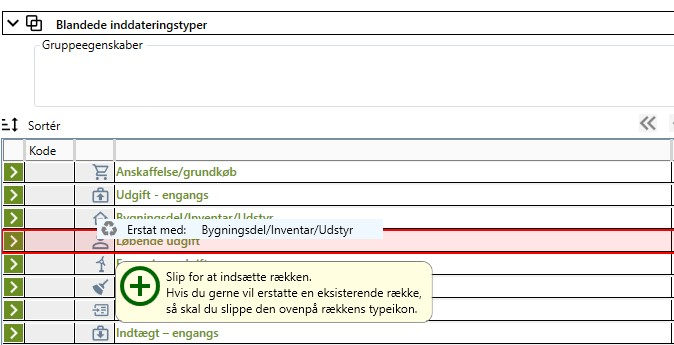
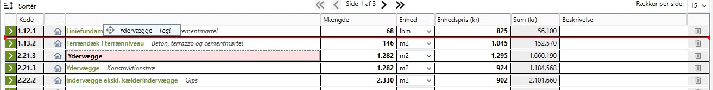
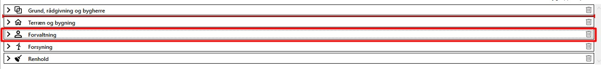
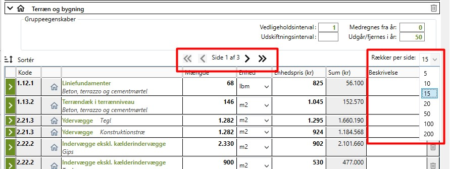
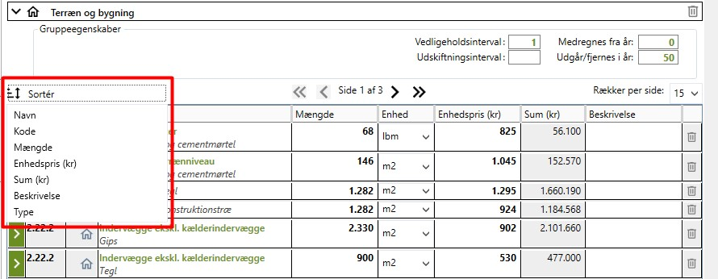
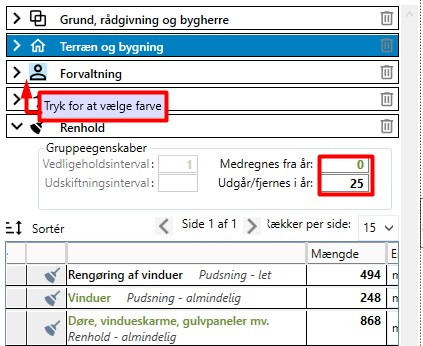

I 'Inddatering' kan du inddatere data og sammensætte din beregning med henblik på at foretage en totaløkonomisk analyse af byggeriet og/eller af forskellige alternativer. Du kan vælge at foretage en samlet beregning for et helt byggeri, hvis det eksempelvis drejer sig om nybyggeri eller totalrenovering. Du kan også vælge at basere din beregning på enkelte bygningsdele, hvis blot enkelte bygningsdele ønskes sammenlignet.

Alle skabeloner kan vises i 'Almindelig grænseflade'. Almindelig grænseflade er opbygget af en 'Inddatering', ['Forudsætninger'](https://lccbyg.dk/help/34/docs/interface/prerequisites/) og ['Rapporter'](https://lccbyg.dk/help/34/docs/interface/reports/). Denne side beskriver inddateringsfeltet i LCCbyg i den almindelige grænseflade. Se [inddatering - den enkle skabelon](https://lccbyg.dk/help/34/docs/interface/den-enkle-skabelon/groupeddataentry-lite/) for beskrivelse af inddateringsfeltet i den enkle grænseflade.

Inddateringsfeltet findes i programmets venstre side, når ’Inddatering’ er åben. Se markeringen på Figur 1.

Figur 1. Markering af inddateringsfelt i LCCbyg.

### Inddateringsfelt

Når du åbner en skabelon (uanset om det er en af standardskabelonerne, en DGNB-skabelon eller den enkle skabelon) vil projektet være tomt bortset fra standardværdier, og den er klar til indtastning af projektspecifikke data. Det tomme projekt er at foretrække, hvis man ønsker at lave en ny totaløkonomisk beregning. DGNB-skabelonen vil dog indeholde fire foruddefinerede grupper ('Grund, rådgivning og bygherre', 'Terræn og bygning', 'Forsyning' og 'Renhold').

Du kan tilføje rækker ved at åbne en gruppe i programmets højreside under en kontoplan og trække den fra højre felt '[nøgletal'](https://lccbyg.dk/help/34/docs/interface/acountplans/) og slippe dem i den ønskede gruppe (se figur 2). Se ['nøgletal'](https://lccbyg.dk/help/34/docs/interface/acountplans/) for flere informationer om navigering i nøgletal.

\[caption id="attachment\_2489" align="alignleft" width="600"\] Figur 2. Træk og slip rækker til den ønskede gruppe.\[/caption\]

\[caption id="attachment\_2494" align="aligncenter" width="1366"\] Figur 3. Animation der viser træk og slip af rækker til den ønskede gruppe.\[/caption\]

Projektspecifikke data kan indtastes i de tomme felter. Ønskes beregninger med andre værdier end standardværdierne kan disse redigeres, og farvekoden på standardværdierne ændres fra grøn til sort, hvilket viser, at der er tale om en brugerinddatering. LCCbyg benytter farvekoder til at synliggøre, hvor data kommer fra. Data med grøn farvekode viser, at værdierne er arvet fra kontoplanen, hvor sort farvekode viser, at værdierne er indtastet af brugeren selv. Ønskes det at gå tilbage til de arvede værdier fra programmet, kan den inddaterede værdi slettes. LCCbyg anvender tre typer af værdier:

- Prædefinerede værdier – de grønne værdier, programmet er født med.
- Inddaterede værdier – de sorte, brugerinddaterede værdier.
- Åbne værdier – tomme felter, der ikke indeholder prædefinerede værdier (fx mængder og enhedspris).

Alle inddateringsfelter har en indbygget lommeregner, således at der er mulighed for at lave simple udregninger. Lommeregneren kan håndtere de fire gængse regneoperationer: Plus, minus, gange og dividere. Efter afslutning af inddatering vil det ikke være muligt at se hvilke tal, der ligger til grund for den beregnede værdi.

Under ‘Inddatering’ skal der indtastes mængder og enhedspriser for hver bygningsdel, mens vedligehold og udskiftning beregnes af LCCbyg. For både vedligehold og udskiftning beregnes og vises værdierne som nutidskroner, dvs. omkostningen som den ville være, hvis den skulle afholdes i dag. LCCbyg sørger for at udregne omkostningen til en nutidsværdi for det pågældende år, hvor omkostningen forfalder.

Følgende afsnit er opdelt i to sektioner:

- ['Tilpasning af informationer i inddatering'](#tilpasinfo) beskriver hvordan inddaterede rækker kan tilpasses for bedst muligt at passe til dit byggeprojekt.
- ['Tilpasning af inddatering'](#tilpasinddatering) beskriver hvordan rækker og grupper kan tilpasses for at danne et visuelt overblik over inddatering

#### Tilpasse informationer i inddatering

Følgende afsnit beskriver dine muligheder for at tilpasse de inddaterede informationer så de passer bedst muligt til dit projekt. Foruden tilpasning af værdier er der følgende muligheder for at tilpasse det inddaterede.

- [Tilføje og slette grupper og rækker](#tilføj)
- [Erstatte rækker](#erstat)
- [Tilføje beskrivelser til rækker](#beskrivelser)
- [Ændre prisudvikling](#prisudvikling)
- [Slette eller tilpasse værdier](#slet)
- [Valg af enheder](#enheder)

##### Tilføje og slette grupper og rækker

Du kan tilføje lige så mange grupper, som du vil, men der skal altid være mindst én gruppe med tilhørende rækker under hvert alternativ. Bemærk at låste rækker ikke kan slettes. Hvis du kommer til at slette en række eller en gruppe ved en fejl, kan du fortryde dit valg. Hvis du tilføjer en eller flere grupper, vil de optræde med navnet ’Unavngiven gruppe’, indtil du omdøber dem. Navne på en gruppe kan ændres ved at trykke på navnet og overskrive det. De kendte tastaturknapper ‘Delete’ og ‘Backspace’ virker også her. På samme måde kan navngivning af rækkedetaljer tilpasses.

Figur 4: Markering af funktioner til at tilføje gruppe, omdøbe gruppe, udfolde gruppe, udfolde række, slette gruppe og slette række

 

Alle grupper og rækker kan klappes sammen eller foldes ud ved hjælp af den lille pil i venstre side ud for navnet på en hovedgruppe eller omkostningstype. Det kan især være nyttigt for kontoplanerne ‘Terræn og bygning’ og ‘Renhold’, da de ofte vil indeholde så mange rækker, at de bliver uoverskuelige.

Rækker slettes ved at trykke på ‘Papirkurv’ yderst til højre for rækken, mens grupper slettes ved at trykke på symbolet for ‘Papirkurv’ i yderst til højre for gruppen. Bemærk, at eventuelle rækker og inddateringer slettes, når du sletter en gruppe. En undtagelse her er DGNB-skabelonen, hvor grupperne er låste og dermed ikke kan slettes.

##### Erstatte rækker

Du kan erstatte en række ved at slippe en anden række oven på rækkens typeikon. Dette er illustreret på Figur 5. Inddaterede mængder og enhedspris fastholdes, imens de øvrige værdier skifter til den nye rækkes prædefinerede værdier.

Figur 5: For at erstatte en eksisterende række, skal du slippe en ny række ovenpå rækkens typeikon.

 

##### Beskrivelser

Rækkerne omfatter også feltet 'Beskrivelser' (se figur 6). Dette felt kan være nyttigt fx til at lave henvisninger til kilden for en omkostning (fx kalkulation foretaget via Molio Prisdata eller egen prisdata), kilden til mængder (fx beregning foretaget i energiprogrammet Be18) eller behov for hjælp hos en kollega (fx "Susanne: Tjek venligst vinduesskema for mængder"). Kommentarerne i feltet 'Bemærkninger' kommer ikke med i rapporten (pdf-format), men vil naturligvis være tilgængelig i projektfilen (xml-format). Derudover omfatter Inddateringen feltet 'Sum', som viser det totale beløb for hver enkelt omkostningstype.

Figur 6: Benyt beskrivelser til at referere til kilder, koordinerer med kollegaer eller skrive remindere til dig selv.

 

De prædefinerede værdier har som udgangspunkt grøn farve. Farven ændres til sort, hvis værdien overskrives af brugeren, og derved kan der skelnes mellem de prædefinerede værdier og inddaterede værdier. Når man inddaterer eller overskriver værdier i de relevante felter, vil LCCbyg beregne nutidsværdi og restværdi for hver enkelt omkostningstype. Beregning af nutidsværdi, restværdi og den valgte materialetype bliver vist under den pågældende række.

Du kan tilføje en beskrivelse af det valgte alternativ i feltet umiddelbart under 'Beregningsperiode', 'Bruttoareal' og 'Rente og prisudvikling'.

##### Prisudvikling

Under hver række er der automatisk opmærkning prisudvikling, som bestemmes ift. Rente og prisudviklingssæt, der er valgt på for alternativet. Rente- og prisudviklingssættene bestemmes under [Forudsætninger](https://lccbyg.dk/help/31/docs/interface/prerequisites/) og inddateres for hele alternativet under [detaljer for alternativ](https://lccbyg.dk/help/34/docs/interface/alternativesdetails/). Hvis du ønsker at tilpasse prisudviklingen for en række, så udfold rækken og vælg den ønskede prisudvikling af dropdown-listen som vist på figur 7.

Figur 7: En rækkes prisudvikling kan tilpasses ved at udfolde rækken og vælge en anden under prisudvikling.

 

##### Brug kun talværdier: Fejlmeddelelser

Der kan kun inddateres talværdier i skemaerne under ’Inddatering’ i LCCbyg. Indtastes bogstaver eller både tal og bogstaver bliver feltet markeret med en rød firkant rundt om indtastningsfeltet. Den røde firkant viser, at applikationen ikke kan beregne omkostningen så længe, der er indtastet bogstaver i feltet. Hvis man indtaster tal i feltet ved siden af, vil applikationen automatisk rette feltet med bogstaver ved at slette de indtastede værdier (bogstaver og tal). Talværdierne rundes desuden op til nærmeste hele tal.

##### Slet

Ændring eller sletning af en værdi fx en mængde sker ved at stille sig i datafeltet og overskrive værdien eller alternativt bruge 'Backspace' eller 'Delete' på dit tastatur. Arvede værdier fra kontoplanen, der er redigeret af brugeren og derved markeret sort [(se Farvekoder)](#farvekoder), vil gå tilbage til den arvede værdi fra kontoplanen og derved blive markeret med grøn, hvis værdien slettes. Du kan genskabe standardværdien ved at slette det brugerinddaterede og trykke enter. Husk at du også kan bruge funktionerne ’Fortryd’ og ’Gendan’ fx ved hjælp af genvejstasterne Ctrl+Z og Ctrl+Y.

##### Valg af enheder

Inddateringsskemaerne for ’Terræn og bygning’, ’Forsyning’ og ’Renhold’ har alle drop down-menuer, så du kan vælge passende enheder til mængderne og priserne. Valg af enhed fra drop down-menuen har ikke indflydelse på beregningen. Uanset om du har valgt enheden ’stk.’, ‘m2’ eller ’lbm’, så anvender applikationen værdien i kolonnen for mængder og enhedsprisen i beregningen. Drop down-menuen er alene en hjælp til dig som bruger, således at mængden og enhedsprisen bedre kan sættes i relation til hinanden.

#### Tilpasning af inddatering

Følgende afsnit beskriver dine muligheder for at skabe et overblik over inddateringen. Du kan bl.a. tilpasse rækkefølgen af grupper og rækker, ændre paginerings- og sorteringsinstillingerne samt benytte farvekoder.

- [Tilpasse rækkefølge af rækker og grupper](#tilpasrækkefølge)
- [Paginering af rækker i grupper](#paginering)
- [Sortering af rækker i grupper](#sortering)
- [Farvekoder på gruppeniveau](#farvekoder)
- [Dynamiske gruppeikoner viser indhold i gruppe](#dynamiskgruppe)

##### Træk og slip af rækker og grupper

Rækkefølgen af rækkerne kan ændres ved at klikke på en række og trække den enten op eller ned. Du kan også gøre kolonner bredere eller smallere ved at trække i kanten af kolonnens overskrift. Det er også muligt at trække en omkostningstype eller bygningsdel fra en gruppe til en anden gruppe ved at trække og slippe den i den gruppe, som du vil have den i (se figur 8).

Figur 8: Træk en række ved at klikke på den og flytte den. Den røde streg markerer indsættelsesstedet, slip rækken for at indsætte.

Rækkefølgen af grupperne kan ligeledes ændres ved at trække og slippe en gruppe. Se figur 9 nedenfor.

Figur 9: Træk en gruppe ved at klikke på den og flytte den. Den røde streg markerer indsættelsesstedet, slip rækken for at indsætte.

 

##### Paginering af inddatering i grupper

Hver gruppe har en indbygget pagineringsfunktion. Som standard vises 15 rækker per side. Antallet af rækker per side indstilles til højre i hver gruppe som vist på figur 10. Du kan bladre imellem siderne ved brug af pilene vist midt på figur 8. Bemærk at '<<' og '>>' bladre til starten henholdsvis slutningen af rækkerne i gruppen.

Figur 10: Pagineringsfunktion - klik på 'rækker per side' for at indstille antallet af rækker per side og brug pilene til at bladre imellem siderne.

 

##### Sortering af inddatering i grupper

Hver gruppe har en indbygget sorteringsfunktion, der gør det muligt at sortere inddateringen i gruppen. Sorteringsfunktionen virker på tværs af alle sider i gruppen. Vælg din ønskede sortering via sorteringsfunktionen markeret til venstre i nedenstående figur. Bemærk, at sorteringen er permanent.

Figur 11: Sorteringsfunktion - brug sorteringsfunktionen til at sortere rækkerne.

 

##### Farvekoder

Grupper kan farvelægges ved at klikke på ikonet ved gruppenavnet. Herved kan der skabes nogle systemer i inddateringen, der gør det nemmere at identificere grupperne.

Figur 12: Farvefunktioner - Klik på gruppeikonet ved siden af gruppenavnet for at tilpasse gruppens farve.

 

##### Dynamiske gruppeikoner viser indhold i gruppe

Der findes 8 forskellige posteringstyper i LCCbyg. Typerne ses af figur 13 sammen med deres respektive typeikoner. Typeikonerne fremgår i hver række i det inddaterede. Hvis en gruppe kun har en posteringstype inddateret, vil dette typeikon fremgå som gruppeikon ved siden af gruppens navn. Derimod vil gruppeikonet ændre sig, hvis der inddateres to eller flere forskellige posteringstyper. De dynamiske gruppeikoner sikrer et let overblik over hvad projektets grupper indeholder.

Figur 13: Dynamiske gruppeikoner afspejler omkostningstyperne af det inddaterede i hver gruppe.
