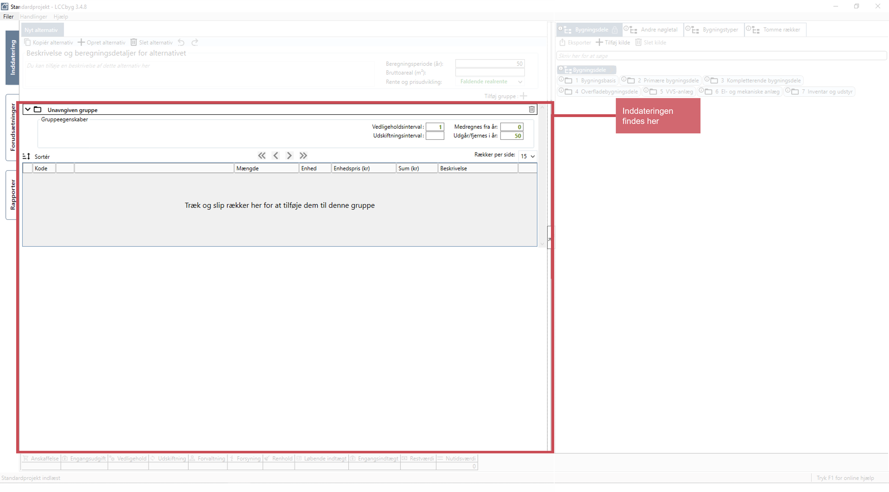
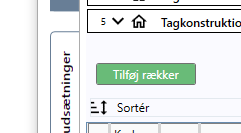
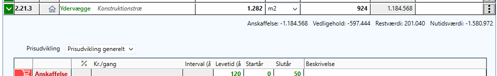
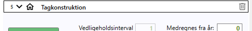
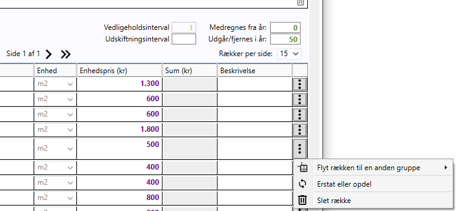
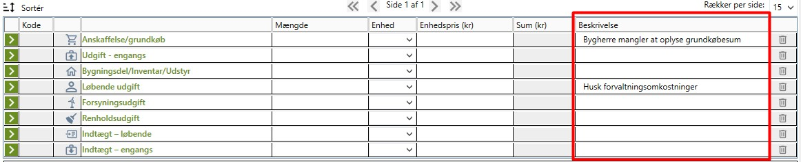
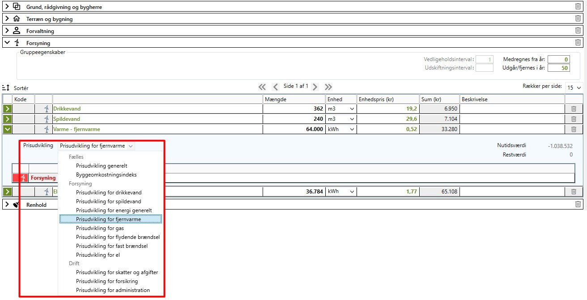
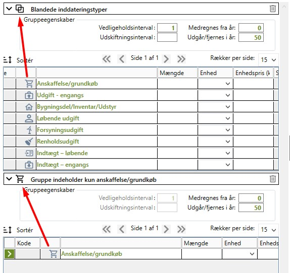
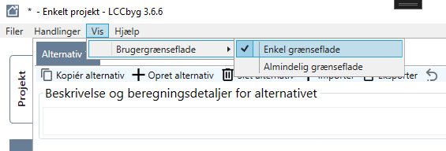

	
 Inddateringsfeltet findes i programmets venstre side, når ’Inddatering’ er åben. 

<figure markdown="1">

<figcaption markdown="1">
Markering af inddateringsfelt i LCCbyg.
</figcaption>
</figure>
 

### Inddatering

I 'Inddatering' kan du inddatere data og sammensætte din beregning med henblik på at foretage en totaløkonomisk analyse af byggeriet og/eller af forskellige alternativer.

Du kan vælge at foretage en samlet beregning for et helt byggeri, hvis det eksempelvis drejer sig om nybyggeri eller totalrenovering. 

Du kan også vælge at basere din beregning på enkelte bygningsdele, hvis blot enkelte bygningsdele ønskes sammenlignet.

Når du åbner en skabelon for du et tomt projekt.

DGNB-skabelonen vil dog indeholde fire foruddefinerede grupper ('Grund, rådgivning og bygherre', 'Terræn og bygning', 'Forsyning' og 'Renhold'), som ikke kan slettes.

 Læs mere under [Biblioteket](../Library) for information om, hvad der kan indsættes.

<figure markdown="1">

<figcaption markdown="1">
Du kan tilføje rækker ved at klikke på "Tilføj række"
</figcaption>
</figure>
 

Data kan indtastes i de tomme felter. For at der kan beregnes priser, skal man som minimum angive en mængde og en enhedspris. I hver række vises en sum for mængde x enhedspris.

Hvis man gerne vil se nutidværdiberegningen for en enklet række, akn den ses ved at åbne rækkedetaljer.

<figure markdown="1">

<figcaption>
Rækkedetaljer åbnet, så man kan se rækkens nutidsværdi og andre posteringer.
</figcaption>
</figure>

De grønne nøgletal, som kan findes både som enhedspriser og i rækkedetaljerne, kan overskrives. Så skifter farven fra grøn/lilla til sort.  Det viser, at der er tale om en brugerinddatering.  Ønskes det at gå tilbage til LCCbygs nøgletal, kan den inddaterede værdi slettes. 

LCCbyg benytter farvekoder til at synliggøre, hvor data kommer fra.

- Nøgletalsværdier – de grønne værdier fra de låste kontoplaner i biblioteket.
- Brugernøgletalsværdier – lilla værdier fra brugerens egne data.
- Brugerinddaterede værdier vises med sort.
 

Alle inddateringsfelter har en lille indbygget regnefunktion, således at der er mulighed for at lave simple udregninger. Lommeregneren kan håndtere de fire gængse regneoperationer: Plus, minus, gange og dividere. Der kan benyttes paranteser i regnestykkerne. *Lommeregneren gemmer ikke regnestykkerne.*

 

Følgende afsnit er opdelt i to sektioner:

- ['Tilpasning af informationer i inddatering'](#tilpasinfo) beskriver hvordan inddaterede rækker kan tilpasses for bedst muligt at passe til dit byggeprojekt.
- ['Tilpasning af inddatering'](#tilpasinddatering) beskriver hvordan rækker og grupper kan tilpasses for at danne et visuelt overblik over inddatering

 
##### Tilføje og slette grupper og rækker

Du kan tilføje lige så mange grupper, som du vil. Hvis du kommer til at slette en række eller en gruppe ved en fejl, kan du få den tilbage med funktionen "fortryd" [CTRL][Z]. 

Når du har tilføjet en gruppe, navngiver du den, ved at klikke på gruppenavnet of skrive et nyt.

<figure markdown="1">
 

 </figure>
 

Alle grupper og rækker kan klappes sammen eller foldes ud. Man kan klikke på den lille pil i venstre side ud for navnet. Grupper kan også foldes ud og klappes sammen, ved at klikke midt på gruppebjælken.

##### Erstatte og opdele rækker

Rækker kan flyttes, erstattes, opdeles og slettes ved at trykke på de tre prikker yderst til højre for rækken. 

Hvis du vælger at erstatte rækken, bibeholdes mængderne, dog således at du erstatter een række med flere, fordeles mængden på de nye rækker. Hvis de nye rækker har enhedspriser bruges disse, ellers vil du beholde den brugerindaterede værdi.

Når du erstatter een række med flere, kan mængder altså ikke ukritisk genbruges, men det giver et udgangspunkt for den fortsatte detaliering.
<figure>
<iframe width="560" height="315" src="https://www.youtube.com/embed/vaz_gWmIy4c" title="YouTube video player" frameborder="0" allow="accelerometer; autoplay; clipboard-write; encrypted-media; gyroscope; picture-in-picture" allowfullscreen></iframe></figure>
 

##### Beskrivelser

Rækkerne omfatter også feltet 'Beskrivelser' (se figur 6). Dette felt kan være nyttigt fx til at lave henvisninger til kilden for en omkostning (fx kalkulation foretaget via Molio Prisdata eller egen prisdata), kilden til mængder (fx beregning foretaget i energiprogrammet Be18) eller behov for hjælp hos en kollega (fx "Susanne: Tjek venligst vinduesskema for mængder"). Kommentarerne i feltet 'Bemærkninger' kommer ikke med i rapporten (pdf-format), men vil naturligvis være tilgængelig i projektfilen (xml-format). Derudover omfatter Inddateringen feltet 'Sum', som viser det totale beløb for hver enkelt omkostningstype.

Figur 6: Benyt beskrivelser til at referere til kilder, koordinerer med kollegaer eller skrive remindere til dig selv.

 

De prædefinerede værdier har som udgangspunkt grøn farve. Farven ændres til sort, hvis værdien overskrives af brugeren, og derved kan der skelnes mellem de prædefinerede værdier og inddaterede værdier. Når man inddaterer eller overskriver værdier i de relevante felter, vil LCCbyg beregne nutidsværdi og restværdi for hver enkelt omkostningstype. Beregning af nutidsværdi, restværdi og den valgte materialetype bliver vist under den pågældende række.

Du kan tilføje en beskrivelse af det valgte alternativ i feltet umiddelbart under 'Beregningsperiode', 'Bruttoareal' og 'Rente og prisudvikling'.

##### Prisudvikling

Under hver række er der automatisk opmærkning prisudvikling, som bestemmes ift. Rente og prisudviklingssæt, der er valgt på for alternativet. Rente- og prisudviklingssættene bestemmes under [Forudsætninger](https://lccbyg.dk/help/31/docs/interface/prerequisites/) og inddateres for hele alternativet under [detaljer for alternativ](https://lccbyg.dk/help/34/docs/interface/alternativesdetails/). Hvis du ønsker at tilpasse prisudviklingen for en række, så udfold rækken og vælg den ønskede prisudvikling af dropdown-listen som vist på figur 7.

Figur 7: En rækkes prisudvikling kan tilpasses ved at udfolde rækken og vælge en anden under prisudvikling.

 

##### Brug kun talværdier: Fejlmeddelelser

Der kan kun inddateres talværdier i skemaerne under ’Inddatering’ i LCCbyg. Indtastes bogstaver eller både tal og bogstaver bliver feltet markeret med en rød firkant rundt om indtastningsfeltet. Den røde firkant viser, at applikationen ikke kan beregne omkostningen så længe, der er indtastet bogstaver i feltet. Hvis man indtaster tal i feltet ved siden af, vil applikationen automatisk rette feltet med bogstaver ved at slette de indtastede værdier (bogstaver og tal). Talværdierne rundes desuden op til nærmeste hele tal.

##### Slet

Ændring eller sletning af en værdi fx en mængde sker ved at stille sig i datafeltet og overskrive værdien eller alternativt bruge 'Backspace' eller 'Delete' på dit tastatur. Arvede værdier fra kontoplanen, der er redigeret af brugeren og derved markeret sort [(se Farvekoder)](#farvekoder), vil gå tilbage til den arvede værdi fra kontoplanen og derved blive markeret med grøn, hvis værdien slettes. Du kan genskabe standardværdien ved at slette det brugerinddaterede og trykke enter. Husk at du også kan bruge funktionerne ’Fortryd’ og ’Gendan’ fx ved hjælp af genvejstasterne Ctrl+Z og Ctrl+Y.

##### Valg af enheder

Inddateringsskemaerne for ’Terræn og bygning’, ’Forsyning’ og ’Renhold’ har alle drop down-menuer, så du kan vælge passende enheder til mængderne og priserne. Valg af enhed fra drop down-menuen har ikke indflydelse på beregningen. Uanset om du har valgt enheden ’stk.’, ‘m2’ eller ’lbm’, så anvender applikationen værdien i kolonnen for mængder og enhedsprisen i beregningen. Drop down-menuen er alene en hjælp til dig som bruger, således at mængden og enhedsprisen bedre kan sættes i relation til hinanden.

#### Tilpasning af inddatering

Følgende afsnit beskriver dine muligheder for at skabe et overblik over inddateringen. Du kan bl.a. tilpasse rækkefølgen af grupper og rækker, ændre paginerings- og sorteringsinstillingerne samt benytte farvekoder.

- [Tilpasse rækkefølge af rækker og grupper](#tilpasrækkefølge)
- [Paginering af rækker i grupper](#paginering)
- [Sortering af rækker i grupper](#sortering)
- [Farvekoder på gruppeniveau](#farvekoder)
- [Dynamiske gruppeikoner viser indhold i gruppe](#dynamiskgruppe)

##### Træk og slip af rækker og grupper

Rækkefølgen af rækkerne kan ændres ved at klikke på en række og trække den enten op eller ned. Du kan også gøre kolonner bredere eller smallere ved at trække i kanten af kolonnens overskrift. Det er også muligt at trække en omkostningstype eller bygningsdel fra en gruppe til en anden gruppe ved at trække og slippe den i den gruppe, som du vil have den i (se figur 8).

Figur 8: Træk en række ved at klikke på den og flytte den. Den røde streg markerer indsættelsesstedet, slip rækken for at indsætte.

Rækkefølgen af grupperne kan ligeledes ændres ved at trække og slippe en gruppe. Se figur 9 nedenfor.

Figur 9: Træk en gruppe ved at klikke på den og flytte den. Den røde streg markerer indsættelsesstedet, slip rækken for at indsætte.

 

##### Paginering af inddatering i grupper

Hver gruppe har en indbygget pagineringsfunktion. Som standard vises 15 rækker per side. Antallet af rækker per side indstilles til højre i hver gruppe som vist på figur 10. Du kan bladre imellem siderne ved brug af pilene vist midt på figur 8. Bemærk at '<<' og '>>' bladre til starten henholdsvis slutningen af rækkerne i gruppen.

Figur 10: Pagineringsfunktion - klik på 'rækker per side' for at indstille antallet af rækker per side og brug pilene til at bladre imellem siderne.

 

##### Sortering af inddatering i grupper

Hver gruppe har en indbygget sorteringsfunktion, der gør det muligt at sortere inddateringen i gruppen. Sorteringsfunktionen virker på tværs af alle sider i gruppen. Vælg din ønskede sortering via sorteringsfunktionen markeret til venstre i nedenstående figur. Bemærk, at sorteringen er permanent.

Figur 11: Sorteringsfunktion - brug sorteringsfunktionen til at sortere rækkerne.

 

##### Farvekoder

Grupper kan farvelægges ved at klikke på ikonet ved gruppenavnet. Herved kan der skabes nogle systemer i inddateringen, der gør det nemmere at identificere grupperne.

Figur 12: Farvefunktioner - Klik på gruppeikonet ved siden af gruppenavnet for at tilpasse gruppens farve.

 

##### Dynamiske gruppeikoner viser indhold i gruppe

Der findes 8 forskellige posteringstyper i LCCbyg. Typerne ses af figur 13 sammen med deres respektive typeikoner. Typeikonerne fremgår i hver række i det inddaterede. Hvis en gruppe kun har en posteringstype inddateret, vil dette typeikon fremgå som gruppeikon ved siden af gruppens navn. Derimod vil gruppeikonet ændre sig, hvis der inddateres to eller flere forskellige posteringstyper. De dynamiske gruppeikoner sikrer et let overblik over hvad alternativets grupper indeholder.

Figur 13: Dynamiske gruppeikoner afspejler omkostningstyperne af det inddaterede i hver gruppe. Når der er blandet indhold, vises to firkanter der overlapper.

<a id="lite" />

### Den enkle kontoplan

#### Skift af visning

I nogle skabelonerne vil der være en ‘Vis’ fane øverst i hovedmenulinjen. Her er der mulighed for at skifte mellem flere visninger. I ‘Den enkle skabelon’ kan der vælges mellem: ‘Enkel grænseflade’ og ‘Almindelig grænseflade’. Begge grænseflader gemmer i samme filformat, og derfor er det muligt at åbne dem i begge visningstyper. Figur 4 viser, hvordan der kan skiftes imellem grænseflader i den enkle skabelon.

<figure markdown="1">
  
 <figcaption>
Skift visning af grænseflade. Denne mulighed findes kun i "Den enkle skabelon"
</figcaption>
</figure>

Den enkle grænseflade er et simpelt visningsformat, hvor der blot skal vælges bygningskomponenter/rækker fra kontoplanen og indtastes mængderne af disse. 

Hvis man vokser ud af Den Enkle Skabelon, og har brug for flere muligheder, kan man skifte til ’Almindelig grænseflade’ (Læs mere under Hovedmenulinjen – Vis).

Hvis der er ændret i nøgletallene i ’Almindelig grænseflade’ og visningsformatet ændres til ’Enkel grænseflade, vil der fremkomme en gul advarselstrekant/disclaimer, der vil minde om, at der er foretaget nogle ændringer i ’Almindelig grænseflade’, der ikke er adgang til i ’Enkel grænseflade’.

