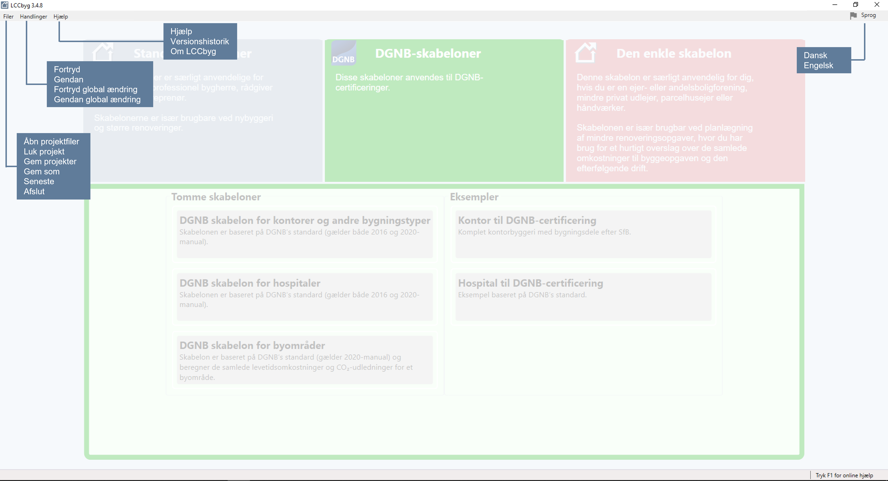

På startsiden består ‘Hovedmenulinjen’ af ‘Filer’ og ‘Hjælp’, imens ’Handlinger’ aktiveres når en skabelon er åbnet. Menupunktet ’Filer’ er aktivt, men nogle af de underliggende funktioner såsom ‘Luk projekt’, ‘Gem’ og ‘Gem som’ er inaktive og vil blive først aktive, når en projektfil er åben. Derimod er alle funktioner i menupunktet ‘Hjælp’ aktive og kan tilgås. Menupunktet ‘Handlinger’ er ikke synlig på ‘Startsiden’, men bliver synlig og aktiv, når et projekt er åben. Hovedmenulinjen vises på figur 1. 

Figur 1: Hovedmenulinjen. Her findes funktioner under knapperne 'Filer', 'Handlinger', 'Hjælp' og 'Sprog'. 

Når en projektfil er åben, så vil alle funktioner i ‘Filer’ og ‘Hjælp’ være aktive. Funktioner i ‘Handlinger’ bliver først aktive, når der tilføjes eller slettes en gruppe. Her beskrives både de funktioner, som er aktive på ‘Startsiden’ og de funktioner, som vil blive først aktive, når et projekt er åbent. Til højre for 'Hovedmenulinjen' findes mulighed for [sprogversionering.](#sprog) 

### Filer

LCCbyg gemmer data som tekstfiler i filformatet xml (lccxml). Formatet gør filerne relativt små og kan dermed nemt udveksles over mail. Bemærk dog, at indsætning af billede eller logo kan få projektfilen til at vokse betydeligt.

_Hvis du vil have to projektfiler åbne på samme tid, skal du åbne applikationen to gange og åbne en projektfil i hver af de to åbne applikationer._

| Kommando |  Beskrivelse    | Genvejstaster |
| --- | --- | --- |
|  Åbn    |  Du kan åbne en   projektfil fra menulinjen ‘Filer’, hvis du allerede har gemt en eller flere   projektfiler. Hvis du vil åbne en gammel projektfil fra en tidligere version   af LCCbyg, skal du i dialogboksen ændre filtypen fra ‘LCCbyg filer (\*.   lccxml)’ til ‘XML-filer (\*.xml)’. Herefter vises de gamle projektfiler fra   tidligere versioner af LCCbyg.     | CTRL + O |
| Luk projekt    |  Ønsker du at komme   tilbage til startsiden, kan du vælge ’Luk projekt’ under ’Filer’ i   menubjælken. Husk eventuelt at gemme alle ændringer, inden projektet lukkes.     | CTRL + F4 |
| Gem  
Gem som |  Du kan gemme filer på to   måder – Gem eller Gem som, som det kendes fra de fleste almindelige   kontorapplikationer. Hvis du bruger Gem, vil filen blive gemt på den   drevplacering, som computeren generelt er sat op til. Hvis du bruger Gem som   – hvilket anbefales – kan du selv bestemme, hvor filen skal gemmes.    | CTRL + S  
CTRL + ALT + S |
|  Seneste    |  Funktionen   ’Filer\\Seneste’ giver en oversigt over de senest åbnede filer. Funktionen   fungerer som en genvej, hvor du kan åbne de senest åbnede filer ved at klikke   på den.    |   |
|  Afslut    |   Du kan lukke applikationen   ved genvejstasten Alt+F4 eller via menulinjens ‘Filer\\Afslut’.    | ALT + F4 |

### Handlinger

Under 'Handlinger' har du mulighed for at fortryde eller gendanne på forskellige niveauer.

| Kommando |  Beskrivelse    | Genvejstaster |
| --- | --- | --- |
| 
Fortryd

Gendan

 | Fortryd og gendan kan aktiveres ved hjælp af genvejstasterne Ctrl+Z og Ctrl+Y. Du kan også finde funktionen via ’Handlinger’ i hovedmenulinjen som vist på Figur 1. | 

CTRL + Z

CTRL + Y

 |
| 

Fortryd global ændring

Gendan global ændring

 | Hvis du vil bruge fortryd og gendan på det øverste niveau, dvs. når der er tilføjet eller slettet en fane, skal du fortryde/gendanne globale ændringer. Funktionerne ligger under ’Handlinger’ og hedder ‘Fortryd global ændring’ og ‘Gendan global ændring’. Funktionen virker til alternativer, prisudviklingssæt og rapporter. |   |

### Hjælp

Du kan få hjælp enten ved at trykke F1 et vilkårligt sted i applikationen eller under funktionen ’Hjælp’ i menubjælken. Husk at tjekke hvilken version af applikation og brugervejledning, som passer sammen.

### Valg af foretrukne sprog – dansk eller engelsk

Du kan vælge hvilken sprogversion, som du vil arbejde med. Hvis du klikker på flaget i øverste højre hjørne, kommer en menu til syne, hvor du kan vælge sprog. Der er pt. to muligheder: Dansk og engelsk. 

Den generelle regel for sprogversionering er, at det er den valgte skabelon, som styrer sproget. Danske skabeloner vil derfor åbne på dansk, og den engelske skabelon vil åbne på engelsk. Hvis du senere åbner en dansk projektfil henholdsvis engelsk projektfil, vil den altså fortsat blive vist på dansk hhv. engelsk. Med andre ord kan du ikke forvente, at alt dansk indhold bliver oversat til engelsk og vice versa ved blot at skifte sprog.
