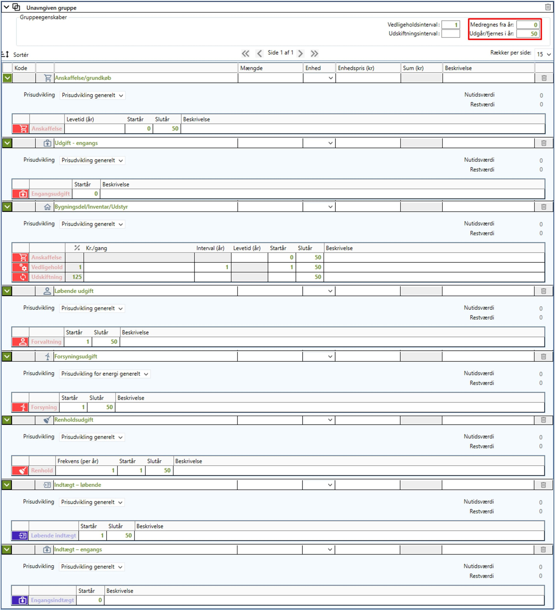

Der findes otte forskellige typer af rækker, der kan anvendes i LCCbyg. Rækketyen afgør, hvordan der regnes og hvor resultaterne posteres.

LCCbyg benytter rækketyper til posteringer. Der findes i alt 8 forskellige rækketyper. Hver af disse indeholder forskellige posteringstyper, som påvirker de totaløkonomiske beregninger.  Tabellen nedenfor indeholder beskrivelser af de 8 forskellige rækketyper, der indgår i LCCbyg. Yderligere viser kolonnen 'Typeikon' de respektive symboler for de forskellige rækketyper. Disse fremkommer både blandt nøgletal og i inddateringen, således du let kan se hvilken rækketyper og derved posteringstype der er tale om. I det efterfølgende beskrives de typiske [rækkedetaljer](#rowdetails) og posteringstyper for de forskellige rækketyper.

| Typeikon | Rækketype | Beskrivelse |
| --- | --- | --- |
|  | Anskaffelse | Benyttes til anskaffelse af materiel til byggeprojektet, som ikke er bygningsdele. Fx. posteres grundkøb som en anskaffelse. |
|  | Engangsudgift | Benyttes til postering af engangsudgifter. Dette kan fx. være honorarer til arkitekter og ingenører eller udgifter til byggeplads. |
|  | Løbende udgift | Benyttes til postering af løbende udgifter. Dette kan eksempelvis være løbende administrationsudgifter, ejendomskat, dækningsafgifter eller forsikringer. |
|  | Bygningsdel | Benyttes til anskaffelse af bygningsdele og bygningstyper. Det vil sige, at denne rækketype benyttes til byggematerialer. |
|  | Forsyningsudgift | Forsyningsudgifter dækker over de løbende udgifter til forsyning af dit byggeprojekt, herunder varme, el og vandforbrug. |
|  | Renholdsudgift | Renholdsudgifter dækker over de løbende udgifter til renhold af dit byggeri. Det kan fx. være vinduespudsning, gulvvask eller snerydning. |
|  | Løbende indtægt | Løbende indtægter dækker over de løbende indtægter dit byggeri har. Det kan fx. være solcellestrøm, vindmøllestrøm eller solvarmeanlæg. |
|  | Engangsindtægt | Engangsindtægter dækker over individuelle indtægter der falder i løbet af beregningsperioden. Dette kan fx. være scrap-værdi for salg af bygningsdele der ikke længere benyttes. |

Alt efter hvilken rækketype, der er inddateret, fremkommer forskellige rækkedetaljer og posteringstyper. Figur 1 viser rækkedetaljer for samtlige rækketyper. Der findes 9 forskellige posteringstyper; Anskaffelse, Engangsudgift, Vedligehold, Udskiftning, Forvaltning, Forsyning, Renhold, Løbende indtægt og Engangsindtægt.

<figure markdown="1">

<figcaption markdown="1">
Eksempel på rækkedetaljer og nogle af de typiske kosttyper.
</figcaption>
</figure>

