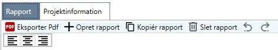
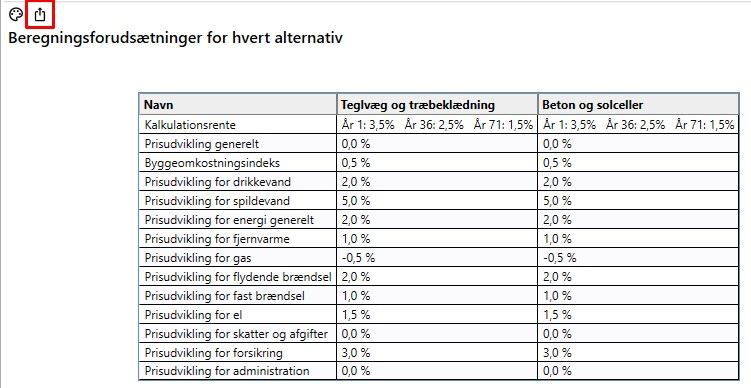

LCCbyg giver dig mulighed for at gemme din rapport ud på to måder

- [Eksport af samlet rapport til PDF.](#eksportrapport)
- [Eksport af tabeller til regneark.](#eksporttabeller) 

### Eksport af rapport

Når du er tilfreds med dine valg, kan du gemme en rapport ved at trykke på 'Eksporter PDF' i værktøjslinjen. Dermed åbner en filvælger, hvor du bestemmer, hvor du vil gemme rapporten. Når LCCbyg har gemt PDF-filen, bliver du spurgt, om du vil åbne den. Klik 'Ja' hvis du vil se rapporten med det samme. Klik 'Nej' hvis du vil vente med at se rapporten.

Figur 1: Eksport af samlet rapport til PDF

Rapporten bliver gemt som et PDF-dokument, der fx kan sendes til beslutningstagere m.fl., som kun er interesserede i at læse rapporten. Hvis modtageren også skal kunne arbejde videre med beregningerne, skal du i stedet sende projektfilen, som gemmes i xml-format (lccxml) og kan genindlæses i applikationen hos modtageren. Det kan du gøre ved at klikke på 'Filer -> Gem som' eller bruge genvejstasten Ctrl+S (Lær mere på [Hovedmenulinjen](https://lccbyg.dk/help/31/docs/interface/help/)). På tilsvarende vis kan du gemme projektinformation som en selvstændig PDF-fil.

### Eksport af tabeller til regneark

Alle tabeller i rapporten kan eksporteres til regneark, som kan åbnes og redigeres i både MS Excel, Libre Office og andre regnearksprogrammer. Tryk på eksportikonet til højre for farvepaletten (se eksempel i figur 2). Dermed åbner en filvælger, hvor du bestemmer, hvor du vil gemme regnearket. Når LCCbyg har gemt filen, bliver du spurgt, om du vil åbne den. Klik 'Ja' hvis du vil se regnearket med det samme. Klik 'Nej' hvis du vil vente med at se regnearket.  
Således kan der arbejdes videre med data fra LCCbyg i andre sammenhænge. 

Figur 2: Eksport af rapporttabel til regneark.
