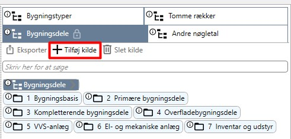
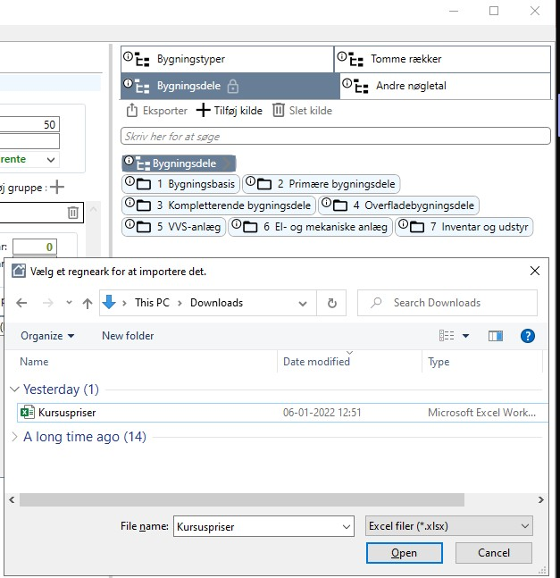
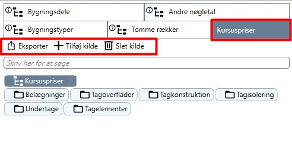

### Import/eksport af nøgletal

Det er muligt at eksportere data til Excel-regneark (xlsx-format). Under ‘Kontoplaner’ er det muligt at eksportere nøgletal til regneark, som sender alle standardværdier over i et regneark, som kan åbnes og redigeres i både MS Excel, Libre Office og andre regnearksprogrammer.

Nedenstående indeholder en kort guide til brug af import/eksport funktionen. Se [https://lccbyg.dk/io/iokeydata/](https://lccbyg.dk/io/iokeydata/) for nærmere beskrivelse. Her finder du også en skabelon til import af egne nøgletal, som du kan tage udgangspunkt i.

#### Tilføj, eksporter og slet kilde

Du kan tilføje dine egne nøgletal ved at klikke på 'Tilføj kilde' som vist på figur 11.

<figure markdown="1">

<figcaption markdown="1">
Figur 11: Tilføj egne nøgletal via 'Tilføj kilde'.
</figcaption>
</figure>
 
 

Vælg den fil, ønsker at importere og afslut med 'Open'/'Åben' (se figur 12)
<figure markdown="1">

<figcaption markdown="1">
Figur 12: Vælg det regneark, der ønskes tilføjet i LCCbyg. 
</figcaption>
</figure>
 

Figur 13 viser, hvordan regnearket 'Kursuspriser' ser ud efter det er importeret til LCCbyg. Du kan eksportere dine egne nøgletal til regneark via 'Eksporter' eller slette kilden, hvis ikke du ønsker at benytte den alligevel.

<figure markdown="1">

<figcaption markdown="1">
Figur 13: Regnearket med kursuspriser er nu importeret. Bemærk muligheder for at eksportere og slette kilden igen. 

</figcaption>
</figure>
 
