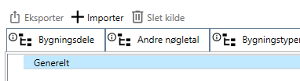
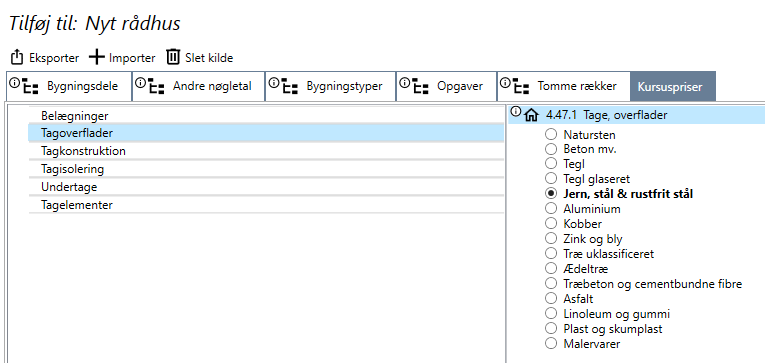

### Import/eksport af nøgletal

###### BIblotek og inddatering	
Det er det samme format, der bruges til at im- og eksportere data, både LCCbygs bibliotek og i LCCbygs inddatering. 

Det er en god ide at holde styr på, om det er biblioteksdata, eller inddateringer der arbejdes med.

Fra bibloteket er det muligt at eksportere nøgletal til et regneark, som kan åbnes og redigeres i Microsoft Excel, Libre Office og andre regnearksprogrammer.

****Bemærk at de låste kontoplaner pt. ikke kan eksporteres.

<a href="https://lccbyg.dk/io/iokeydata/](https://lccbyg.dk/io/iokeydata/" target="_blank">Se evt. beskrivelsen af LCCbygs im- og eksportformat</a> ( åbner i en ny fane). Her finder du også et eksempel til import af egne nøgletal, som du kan tage udgangspunkt i.

#### Tilføj, eksporter og slet kontoplaner

Du kan tilføje dine egne nøgletal ved at klikke på 'Importer'

<figure markdown="1">

<figcaption markdown="1">
Tilføj egne nøgletal via 'Importer'.
</figcaption>
  
</figure>

Vælg den fil, ønsker at importere og afslut med 'Open'/'Åben'
 
 

Her ses regnearket 'Kursuspriser' efter det er importeret til LCCbyg. Du kan eksportere dine egne nøgletal til regneark via 'Eksporter' eller slette kilden, hvis ikke du ønsker at benytte den alligevel.

<figure markdown="1">

<figcaption markdown="1">
Figur 13: Regnearket med kursuspriser er nu importeret. Bemærk muligheder for at eksportere og slette kilden igen. 

</figcaption>
</figure>
 
