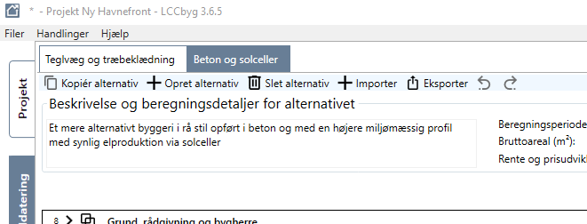

LCCbyg giver dig muligheder for at importere og eksportere dine inddateringer.

Du kan bl.a bruge denne funktion til:

* Eksportere et alternativ til et regneark
* Importere et alternativ fra et regneark
* TIlføje til et eksisteren alternativ.
* Flytte data fra et projekt til et andet projekt.

###### BIblotek og inddatering	

Når du importere og eksportere data, får du både nøgletal og brugerdata med.

Hvis nøgletallene er de samme som i LCCbygs låste kontoplaner, bliver dine rækker vist med en grøn pil. Hvis der er nøgletal som ikke findes i LCCbygs låste kontoplaner, bliver rækken vist med lilla pil. Hvis der ikke findes nøgletal, eller hvis de er overskrevet af brugerværdier, har rækken en sort pil.

Det er det samme format, der bruges til at im- og eksportere data, både LCCbygs bibliotek og i LCCbygs inddatering. 

Det er en god ide at holde styr på, om det er biblioteksdata, eller inddateringer der arbejdes med.

 

 

