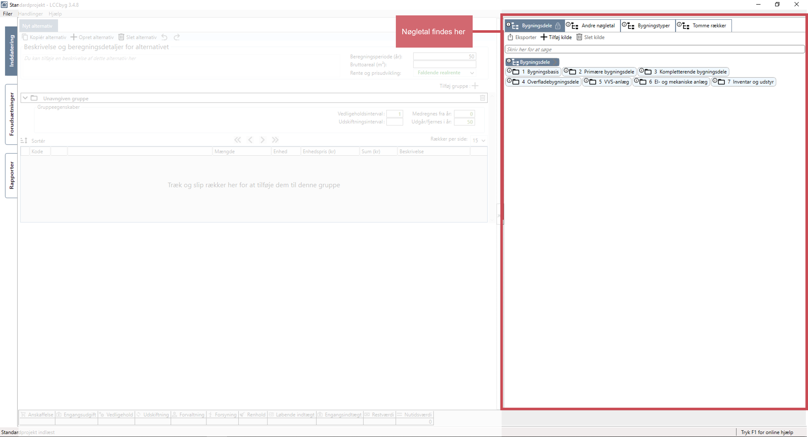
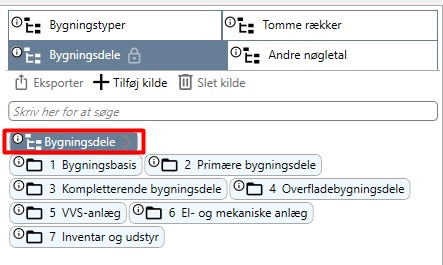
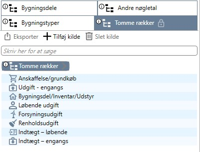
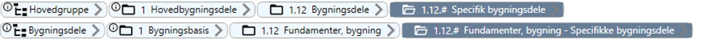
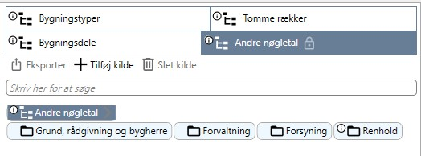
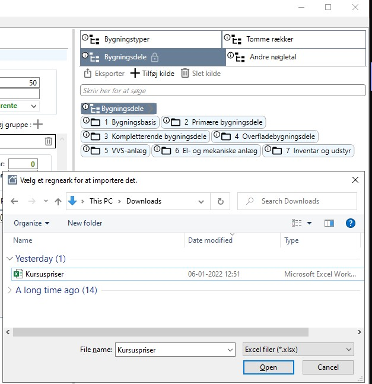

Følgende afsnit beskriver de tilgængelige nøgletal i LCCbyg, introducerer [navigationsprincippet](#navigation) i nøgletal, herunder beskrivelse af [søgefunktionen](#søgefunktion), og beskriver muligheden for [at importere og eksportere egne nøgletal](#importeksport). Nøgletallene findes i programmets højre side, når fanen inddatering er åben (se figur 1).

Figur 1: Nøgletallene findes i programmets højre side, når fanen inddatering er åben.

Alle skabeloner kommer med en eller flere faner med nøgletal. Du skal bruge nøgletalene til at sammensætte og tilpasse dine beregninger til det aktuelle behov. LCCbyg består på tværs af skabeloner af følgende faner med nøgletal:

- [Tomme rækker](#tommerækker) findes i alle skabeloner, undtagen DGNB Byrum og den enkle skabelon. Tomme rækker kan benyttes, når skabelonens andre nøgletal ikke passer på dit projekt.
- [Bygningsdele](#bygningsdele) findes i alle standardskabeloner. Bygningsdelene er baseret på BUILD's [levetidstabel](https://lccbyg.dk/levetidstabel2021/) og klassificeret efter SfB-systemet.
- [Andre nøgletal](#andrenøgletal) findes i alle standardskabelonerne. [Andre nøgletal](#andrenøgletal) indeholder nøgletal for grund, rådgivning, bygherreomkostninger, forvaltning, forsyning og renhold.
- [Bygningstyper](#bygningstyper) findes i alle standardskabelonerne. Nøgletallene kan anvendes til indledende planlægning af byggeprojekter eller byplanlægning.
- [Nøgletal - SfB](#bossinf) benyttes i DGNB skabelonen til kontorer og andre bygningstyper samt DGNB hospital. Nøgletallene er baseret på DGNB-manualerne.
- [Målsætninger](https://lccbyg.dk/help/34/docs/interface/groupeddataentry-almeneboliger/) findes i skabelonen til [Almene boliger med SfB.](https://lccbyg.dk/help/34/docs/interface/groupeddataentry-almeneboliger/) Målsætninger indeholder kriterier der kan opstilles til vurdering af hvert alternativ.
- [DGNB byrum](https://lccbyg.dk/help/34/docs/interface/groupeddataentry-dgnb-by/) benyttes i DGNB Byområder skabelonen. Nøgletallene er baseret på DGNB 2020-manualen og benyttes til at beregne totaløkonomi og CO2\-udledninger for et byområde.
- [Opgaver](https://lccbyg.dk/help/34/docs/interface/den-enkle-skabelon/groupeddataentry-lite/) benyttes i den enkle skabelon, der benyttes til simple totaløkonomiske beregninger.

### Navigation i kontoplaner

Navigationsprincippet er fælles for alle nøgletalsfaner. I det følgende forklares princippet for navigation på baggrund af fanen indeholdende [bygningsdele](#bygningsdele) (se [bygningsdele](#bygningsdele) for nærmere beskrivelse af hvad disse nøgletal indeholder). Der findes grundlæggende mapper og rækker i nøgletalsvisningen.

Figur 2 viser fanen, når den åbnes i LCCbyg. I bygningsdele findes 7 hovedmapper. Hvis du trykker på mapperne, kan du se hvad de indeholder. Den røde firkant markerer hovedmappen for nøgletallene i fanen. Den kan du altid trykke på for at komme tilbage til udgangspunktet.

<figure markdown="1">

 
<figcaption markdown="1">
Figur 2: Eksempel på mappestruktur i fanen med nøgletal vedrørende bygningsdele.
</figcaption>
</figure>

Figur 3 viser mappestrukturen et niveau dybere nede i hierarkiet. Den røde firkant i toppen af billedet viser stien for den åbne mappe, og du kan altid bruge denne til at navigere imellem mapper på overliggende niveauer. Den nederste røde firkant viser, at der er yderligere rækker og undergrupper. Du kan trykke på mapperne for at se, hvad de indeholder.
<figure markdown="1">

<figcaption markdown="1">
Figur 3: Brug mapperne _over_ rækkerne til at gå et eller flere mappeniveauer op. Brug mapperne _under_ rækkerne til at gå et niveau ned.
</figcaption>
</figure>

Der er med andre ord et generelt princip, hvor mapper, der vises over rækkerne, kan bruges til at gå en eller flere led op i en mappestruktur, imens mapper under rækkerne kan bruges til at gå et niveau ned ad gangen. Hvis ikke der er flere mapper under rækkerne, er der ikke yderligere undergrupperinger af nøgletallene. Figur 4 viser, hvordan stien for placeringen kan vokse. Bemærk at den aktive mappe er markeret med mørkeblå. Figur 4 viser ydermere forskellige detaljer, der generelt kan læses ud af rækker under nøgletal. For nærmere beskrivelse af rækketype og detaljer - se [rækketyper.](https://lccbyg.dk/help/34/docs/interface/costtypes/)

Figur 4: Brug stien til at gå en eller flere mapper op.

 

#### Søgefunktion

Hvis ikke du ved hvor en specifik række befinder sig, kan det være nyttigt at bruge søgefunktionen. Under fanerne med nøgletal kan du foretage en søgning efter rækker. Søgningen sker inden for den valgte fane. Hvis rækkerne har koder, kan du også søge efter dem. Du kan trække den relevante række direkte fra søgeresultatet og sætte den ind i den ønskede gruppe. Søgning afsluttes ved at trykke på den grå papirkurv i søgefeltet.

Figur 5: Søg efter rækker ved hjælp af søgefunktionen og indsæt direkte i inddateringen.

 

### Nøgletal og kilder

I skabelonerne for de fagprofessionelle bruger er der seks kontoplaner, som går igen på tværs af skabelonerne, men detaljeringsgraden mv. er forskellig fra skabelon til skabelon. Beregningsmetoderne for de seks kontoplaner varierer også fra at regne alene på anskaffelsesomkostninger til alene at regne på driftsomkostninger i forskellige varianter og videre til en kombination af både anskaffelses- og driftsomkostninger, herunder udskiftning/genopretning. Kontoplaner født med lcc er låste og kan ikke ændres. For mulighed for at oprette dine egne nøgletal - se ['Import/eksport af nøgletal'](#eksport).

#### Tomme rækker

Alle skabeloner undtagen den enkle skabelon og DGNB-byrum har ‘Tomme rækker’ som kilde i LCCbygs højreside.

Der findes en tom række for hver af de otte generelle [rækketyper.](https://lccbyg.dk/help/34/docs/interface/costtypes/) På den måde kan du selv inddatere enkelte rækker med egne nøgletal. Hvis du har større datasæt med nøgletal, du ønsker at basere dine beregninger på, kan du med fordel benytte [import og eksport af egne nøgletal](#importeksport).

Figur 6 viser fanebladet med de otte forskellige tomme rækker.

Figur 6: Tomme rækker kan bruges til inddatering, når de øvrige nøgletal ikke passer til dit projekt.

 

#### Bygningsdele

Alle standardskabeloner har fanebladet 'Bygningsdele' i højresiden. Bygningsdelene er baseret på BUILD's [levetidstabel](https://lccbyg.dk/levetidstabel2021/). Bygningsdelene er opbygget i følgende hierarki og følger SfB-klassifikationssystemet.

- Hovedgrupper
- Hovedbygningsdele
- Bygningsdele
- Specifikke bygningsdele.

Hovedgrupperne er hovedmapper indeholdende hovedbygningsdele, bygningsdele og specifikke bygningsdele. Nedenstående viser hierarkiet i nøgletalene baseret på et eksempel.

Figur 7: Eksempel på sti af mapper i LCCbyg med beskrivelse af deres hierarkiske betegnelse jf. SfB-klassifikationssystemet.

#### Bygningstyper

Fanen med 'Bygningstyper' indeholder nøgletal for forskellige bygningstyper. Nøgletalene er defineret på baggrund af BUILD's [levetidstabel](https://lccbyg.dk/levetidstabel2021/). Bygningstyperne er opbygget efter seneste udgave af BBR-koderne fra maj 2020.

Figur 8 viser nøgletallene for bygningstyperne, når denne fane vælges. Fanen indeholder 13 grupper. Hver af disse grupper er derudover repræsenteret ved en aggregeret række, der sammenfatter levetiden for alle bygningstyper indeholdt i den respektive gruppe. Fx. indeholder gruppen ‘Helårsbeboelse’ 8 rækker med levetider fra 40 til 120 år, imens rækken ‘Helårsbeboelse’ har en levetid på 120 år. For nærmere beskrivelse se BUILD’s  [levetidstabel](https://lccbyg.dk/levetidstabel2021/). 

Figur 8: Bygningstyper kan benyttes til byplanlægning eller tidlige overslag på totaløkonomi for en byggeprojekt

 

#### Andre nøgletal

Fanen 'Andre nøgletal' indeholder nøgletal for henholdsvis 'Grund, rådgivning og bygherre', 'Forvaltning', 'Forsyning' og 'Renhold'.

Figur 9: Fanen med andre nøgletal indeholder nøgletal for 'Grund, rådgivning og bygherre', 'Forvaltning', 'Forsyning' og 'Renhold'.

 

#### Nøgletal - SfB

I DGNB-skabelonerne findes nøgletal under ‘Nøgletal – SfB’. Denne indeholder nøgletal, der benyttes i forbindelse med DGNB-certificeringer for byggerier. Her finder du alle de rækker, du kan have brug for i forbindelse med totaløkonomiske beregninger af dit DGNB-projekt.

Figur 10: Nøgletal SfB.

Nøgletallene i 'Nøgletal - SfB' fem elementer:

- Grund, rådgivning og bygherre
- Terræn og bygning
- Forvaltning
- Forsyning
- Renhold

Nøgletallene i grupperne 'Grund, rådgivning og bygherre', 'Forvaltning', 'Forsyning' og 'Renhold' svarer til nøgletallene under 'Andre nøgletal', som benyttes i standardskabelonerne.

### Import/eksport af nøgletal

Det er muligt at eksportere data til Excel-regneark (xlsx-format). Under ‘Kontoplaner’ er det muligt at eksportere nøgletal til regneark, som sender alle standardværdier over i et regneark, som kan åbnes og redigeres i både MS Excel, Libre Office og andre regnearksprogrammer.

Nedenstående indeholder en kort guide til brug af import/eksport funktionen. Se [https://lccbyg.dk/io/iokeydata/](https://lccbyg.dk/io/iokeydata/) for nærmere beskrivelse. Her finder du også en skabelon til import af egne nøgletal, som du kan tage udgangspunkt i.

#### Tilføj, eksporter og slet kilde

Du kan tilføje dine egne nøgletal ved at klikke på 'Tilføj kilde' som vist på figur 11.

Figur 11: Tilføj egne nøgletal via 'Tilføj kilde'.

 

Vælg den fil, ønsker at importere og afslut med 'Open'/'Åben' (se figur 12)

Figur 12: Vælg det regneark, der ønskes tilføjet i LCCbyg. 

 

Figur 13 viser, hvordan regnearket 'Kursuspriser' ser ud efter det er importeret til LCCbyg. Du kan eksportere dine egne nøgletal til regneark via 'Eksporter' eller slette kilden, hvis ikke du ønsker at benytte den alligevel.

Figur 13: Regnearket med kursuspriser er nu importeret. Bemærk muligheder for at eksportere og slette kilden igen. 

Se [import/eksport](https://lccbyg.dk/io/iokeydata/) for nærmere beskrivelse.
