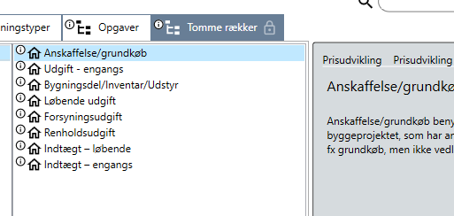
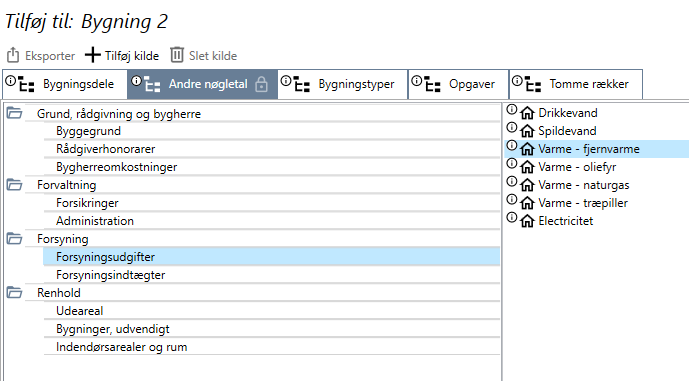
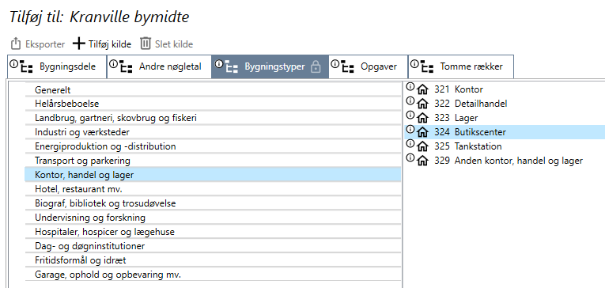

 

I LCCbygs bibliotek deles rækkerne op i forskellige kontoplaner. 

Du kan læse om nogen af dem her og se en introduktionsvideo

### Biblioteket:

<figure>
[<iframe width="560" height="315" src="https://www.youtube.com/watch?v=qYrX4Afdh7M" title="YouTube video player" frameborder="0" allow="accelerometer; autoplay; clipboard-write; encrypted-media; gyroscope; picture-in-picture" allowfullscreen></iframe>](https://youtu.be/qYrX4Afdh7M)
</figure>

### Kontoplaner:

<figure>
<iframe width="560" height="315" src="https://www.youtube.com/watch?v=p6fD9WkwrIo" title="YouTube video player" frameborder="0" allow="accelerometer; autoplay; clipboard-write; encrypted-media; gyroscope; picture-in-picture" allowfullscreen></iframe>
</figure>

#### Tomme rækker

De fleste skabeloner har kontoplanen ‘Tomme rækker’   Hvis du ikke finder den række du skal bruge i de andre kontoplaner, kan du tage en række fra Tomme rækker.

Tomme rækker indeholder ikke nøgletal, så prøv at finde en relevant række i en af de andre kontoplaner først.

Der findes en tom række for hver af de otte generelle rækketyper [Læs mere om rækketyperne her](../General/rowtypes)

<figure markdown="1">
[
<figcaption markdown="1">
 Tomme rækker kan bruges til inddatering, når de øvrige nøgletal ikke passer til dit projekt.
</figcaption>
</figure>

Hvis du har større datasæt med nøgletal, du ønsker at basere dine beregninger på, kan du med fordel benytte funktionen "Indsæt kilde". Læs mere om den her: [Import og eksport af egne nøgletaal](../ImportExport/importexport_library)

#### Bygningsdele

Alle standardskabeloner har kontoplanen 'Bygningsdele'. Bygningsdelene er baseret på BUILD's levetidstabel, der er bygget over SfB-klassifikationssystemet.

I kontoplanen kan man både vælge rækker på et overordnet niveau ( kode 1, 2, 3 etc.) på mellem niveau ( kode 1.x, 2,x , 3. x etc) og på konstruktionsniveau ( kode 1.3.23 etc.)

Du kan læse om hvordan niveauerne kan benyttes her : [Navigation i biblioteket](../Userinterface/userinterface_library)

<a href="https://lccbyg.dk/levetidstabel2021/" target="_blank">Læs mere om levetidstabellen her.</a> (Åbner i ny fane)
 

#### Andre nøgletal

Fanen 'Andre nøgletal' indeholder nøgletal for henholdsvis 'Grund, rådgivning og bygherre', 'Forvaltning', 'Forsyning' og 'Renhold'.

<figure markdown="1">

<figcaption markdown="1">
Figur 9: Fanen med andre nøgletal indeholder nøgletal for 'Grund, rådgivning og bygherre', 'Forvaltning', 'Forsyning' og 'Renhold'.
</figcaption>
</figure>
 

 
#### Bygningstyper

Fanen med 'Bygningstyper' indeholder nøgletal for forskellige bygningstyper. Nøgletalene er defineret på baggrund af BUILD's [levetidstabel](https://lccbyg.dk/levetidstabel2021/). Bygningstyperne er opbygget efter seneste udgave af BBR-koderne fra maj 2020.

Figur 8 viser nøgletallene for bygningstyperne, når denne fane vælges. Fanen indeholder 13 grupper. Hver af disse grupper er derudover repræsenteret ved en aggregeret række, der sammenfatter levetiden for alle bygningstyper indeholdt i den respektive gruppe. Fx. indeholder gruppen ‘Helårsbeboelse’ 8 rækker med levetider fra 40 til 120 år, imens rækken ‘Helårsbeboelse’ har en levetid på 120 år. For nærmere beskrivelse se BUILD’s  [levetidstabel](https://lccbyg.dk/levetidstabel2021/). 

<figure markdown="1">

<figcaption markdown="1">
Figur 8: Bygningstyper kan benyttes til byplanlægning eller tidlige overslag på totaløkonomi for en byggeprojekt
</figcaption>
</figure>
 
#### Opgaver

 Denne kontoplane udformet med udgangspunkt i 20-punkts listen for typiske drifts- og vedligeholdsplaner for ejerboligforeninger og andelsboligforeninger. Du kan læse mere om de forskellige aspekter og bygningskomponenter under <a href="https://lccbyg.dk/videnskilder/" >Videnskilder</a>  på lccbyg.dk/videnskilder/.

Kontoplanen er den der benyttes i "Den enkle skabelon, og har udover nøgletal med priser, en stor mængde relevant byggefalglig viden, som tilgås ved at klikke på informationsikonerne.
 

 
