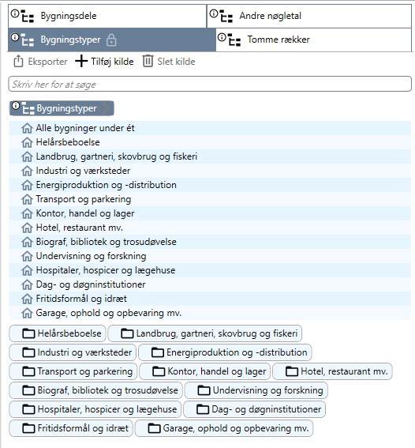

 

### Nøgletal og kilder

I skabelonerne for de fagprofessionelle bruger er der seks kontoplaner, som går igen på tværs af skabelonerne, men detaljeringsgraden mv. er forskellig fra skabelon til skabelon. Beregningsmetoderne for de seks kontoplaner varierer også fra at regne alene på anskaffelsesomkostninger til alene at regne på driftsomkostninger i forskellige varianter og videre til en kombination af både anskaffelses- og driftsomkostninger, herunder udskiftning/genopretning. Kontoplaner født med lcc er låste og kan ikke ændres. For mulighed for at oprette dine egne nøgletal - se ['Import/eksport af nøgletal'](#eksport).

#### Tomme rækker

Alle skabeloner undtagen den enkle skabelon og DGNB-byrum har ‘Tomme rækker’ som kilde i LCCbygs højreside.
<figure markdown="1">
[
<figcaption markdown="1">
 Tomme rækker kan bruges til inddatering, når de øvrige nøgletal ikke passer til dit projekt.
</figcaption>
</figure>

Der findes en tom række for hver af de otte generelle [rækketyper.](https://lccbyg.dk/help/34/docs/interface/costtypes/) På den måde kan du selv inddatere enkelte rækker med egne nøgletal. 

Hvis du har større datasæt med nøgletal, du ønsker at basere dine beregninger på, kan du med fordel benytte [import og eksport af egne nøgletal](../ImportExport/importexport_library).

#### Bygningsdele

Alle standardskabeloner har fanebladet 'Bygningsdele' i højresiden. Bygningsdelene er baseret på BUILD's levetidstabel. Bygningsdelene er opbygget i følgende hierarki og følger SfB-klassifikationssystemet.

- Hovedgrupper
- Hovedbygningsdele
- Bygningsdele
- Specifikke bygningsdele.

Hovedgrupperne er hovedmapper indeholdende hovedbygningsdele, bygningsdele og specifikke bygningsdele. Nedenstående viser hierarkiet i nøgletalene baseret på et eksempel.

<a href="https://lccbyg.dk/levetidstabel2021/" target="_blank">Læs mere om levetidstabellen her.</a> (Åbner i ny fane)
 
 
#### Bygningstyper

Fanen med 'Bygningstyper' indeholder nøgletal for forskellige bygningstyper. Nøgletalene er defineret på baggrund af BUILD's [levetidstabel](https://lccbyg.dk/levetidstabel2021/). Bygningstyperne er opbygget efter seneste udgave af BBR-koderne fra maj 2020.

Figur 8 viser nøgletallene for bygningstyperne, når denne fane vælges. Fanen indeholder 13 grupper. Hver af disse grupper er derudover repræsenteret ved en aggregeret række, der sammenfatter levetiden for alle bygningstyper indeholdt i den respektive gruppe. Fx. indeholder gruppen ‘Helårsbeboelse’ 8 rækker med levetider fra 40 til 120 år, imens rækken ‘Helårsbeboelse’ har en levetid på 120 år. For nærmere beskrivelse se BUILD’s  [levetidstabel](https://lccbyg.dk/levetidstabel2021/). 

<figure markdown="1">

<figcaption markdown="1">
Figur 8: Bygningstyper kan benyttes til byplanlægning eller tidlige overslag på totaløkonomi for en byggeprojekt
</figcaption>
</figure>
 
 

#### Andre nøgletal

Fanen 'Andre nøgletal' indeholder nøgletal for henholdsvis 'Grund, rådgivning og bygherre', 'Forvaltning', 'Forsyning' og 'Renhold'.

<figure markdown="1">

<figcaption markdown="1">
Figur 9: Fanen med andre nøgletal indeholder nøgletal for 'Grund, rådgivning og bygherre', 'Forvaltning', 'Forsyning' og 'Renhold'.
</figcaption>
</figure>
 

#### Nøgletal - SfB

I DGNB-skabelonerne findes nøgletal under ‘Nøgletal – SfB’. Denne indeholder nøgletal, der benyttes i forbindelse med DGNB-certificeringer for byggerier. Her finder du alle de rækker, du kan have brug for i forbindelse med totaløkonomiske beregninger af dit DGNB-projekt.
<figure markdown="1">

<figcaption markdown="1">
Figur 10: Nøgletal SfB.
</figcaption>
</figure>
 
Nøgletallene i 'Nøgletal - SfB' fem elementer:

- Grund, rådgivning og bygherre
- Terræn og bygning
- Forvaltning
- Forsyning
- Renhold

Nøgletallene i grupperne 'Grund, rådgivning og bygherre', 'Forvaltning', 'Forsyning' og 'Renhold' svarer til nøgletallene under 'Andre nøgletal', som benyttes i standardskabelonerne.

 
