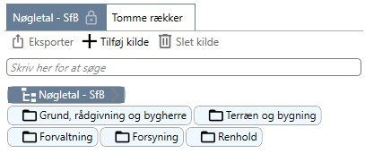

 

### Nøgletal og kilder

I LCCbygs bibliotek deles rækkerne op i forskellige kontoplaner. Du kan læse om nogen af dem her.

#### Tomme rækker

De fleste skabeloner har kontoplanen ‘Tomme rækker’   Hvis du ikke finder den række du skal bruge i de andre kontoplaner, kan du tage en række fra Tomme rækker.

Tomme rækker indeholder ikke nøgletal, så prøv at finde en relevant række i en af de andre kontoplaner først.

Der findes en tom række for hver af de otte generelle rækketyper [Læs mere om rækketyperne her](../General/rowtypes)

<figure markdown="1">
[
<figcaption markdown="1">
 Tomme rækker kan bruges til inddatering, når de øvrige nøgletal ikke passer til dit projekt.
</figcaption>
</figure>

Hvis du har større datasæt med nøgletal, du ønsker at basere dine beregninger på, kan du med fordel benytte [import og eksport af egne nøgletal](../ImportExport/importexport_library).

#### Bygningsdele

Alle standardskabeloner har fanebladet 'Bygningsdele' i højresiden. Bygningsdelene er baseret på BUILD's levetidstabel. Bygningsdelene er opbygget i følgende hierarki og følger SfB-klassifikationssystemet.

- Hovedgrupper
- Hovedbygningsdele
- Bygningsdele
- Specifikke bygningsdele.

Hovedgrupperne er hovedmapper indeholdende hovedbygningsdele, bygningsdele og specifikke bygningsdele. Nedenstående viser hierarkiet i nøgletalene baseret på et eksempel.

<a href="https://lccbyg.dk/levetidstabel2021/" target="_blank">Læs mere om levetidstabellen her.</a> (Åbner i ny fane)
 
 
#### Bygningstyper

Fanen med 'Bygningstyper' indeholder nøgletal for forskellige bygningstyper. Nøgletalene er defineret på baggrund af BUILD's [levetidstabel](https://lccbyg.dk/levetidstabel2021/). Bygningstyperne er opbygget efter seneste udgave af BBR-koderne fra maj 2020.

Figur 8 viser nøgletallene for bygningstyperne, når denne fane vælges. Fanen indeholder 13 grupper. Hver af disse grupper er derudover repræsenteret ved en aggregeret række, der sammenfatter levetiden for alle bygningstyper indeholdt i den respektive gruppe. Fx. indeholder gruppen ‘Helårsbeboelse’ 8 rækker med levetider fra 40 til 120 år, imens rækken ‘Helårsbeboelse’ har en levetid på 120 år. For nærmere beskrivelse se BUILD’s  [levetidstabel](https://lccbyg.dk/levetidstabel2021/). 

<figure markdown="1">

<figcaption markdown="1">
Figur 8: Bygningstyper kan benyttes til byplanlægning eller tidlige overslag på totaløkonomi for en byggeprojekt
</figcaption>
</figure>
 
 

#### Andre nøgletal

Fanen 'Andre nøgletal' indeholder nøgletal for henholdsvis 'Grund, rådgivning og bygherre', 'Forvaltning', 'Forsyning' og 'Renhold'.

<figure markdown="1">

<figcaption markdown="1">
Figur 9: Fanen med andre nøgletal indeholder nøgletal for 'Grund, rådgivning og bygherre', 'Forvaltning', 'Forsyning' og 'Renhold'.
</figcaption>
</figure>
 

#### Nøgletal - SfB

I DGNB-skabelonerne findes nøgletal under ‘Nøgletal – SfB’. Denne indeholder nøgletal, der benyttes i forbindelse med DGNB-certificeringer for byggerier. Her finder du alle de rækker, du kan have brug for i forbindelse med totaløkonomiske beregninger af dit DGNB-projekt.
<figure markdown="1">

<figcaption markdown="1">
Figur 10: Nøgletal SfB.
</figcaption>
</figure>
 
Nøgletallene i 'Nøgletal - SfB' fem elementer:

- Grund, rådgivning og bygherre
- Terræn og bygning
- Forvaltning
- Forsyning
- Renhold

Nøgletallene i grupperne 'Grund, rådgivning og bygherre', 'Forvaltning', 'Forsyning' og 'Renhold' svarer til nøgletallene under 'Andre nøgletal', som benyttes i standardskabelonerne.

 
