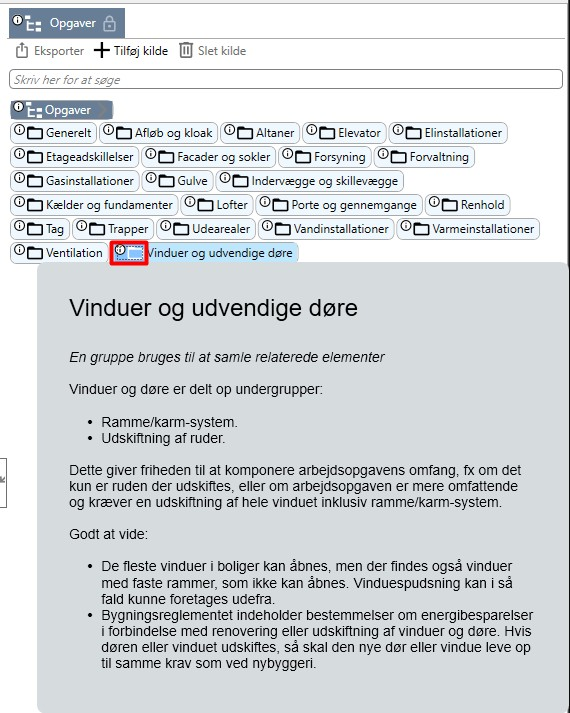

I den enkle skabelon findes én fane med nøgletal. Denne udformet med udgangspunkt i 20-punkts listen for typiske drifts- og vedligeholdsplaner for ejerboligforeninger og andelsboligforeninger. Du kan læse mere om de forskellige aspekter og bygningskomponenter under ['Videnskilder'](https://lccbyg.dk/videnskilder/) på lccbyg.dk/videnskilder/.

Figur 1 viser 'Opgaver' fordelt på de 20 punkter. Hver af disse indeholder én eller flere rækker, der kan inddateres. Du kan klikke på informationstegnet ud for typeikonet for at læse nærmere om den valgte gruppe eller række, som markeret på nedenstående figur.

Figur 1: Her ses kontoplanen for 'Den enkle skabelon'
