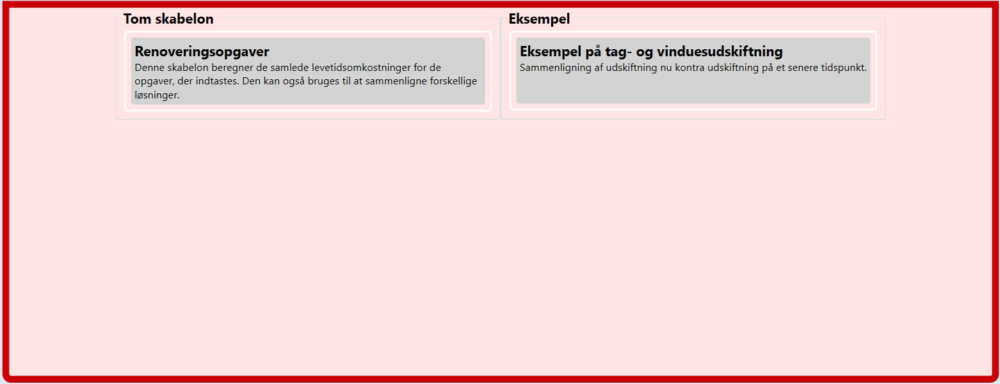

Den enkle skabelon er målrettet den ikke-professionelle bruger og er særlig anvendelig for dig, hvis du er en ejer- eller andelsboligforening, mindre privat udlejer, parcelhusejer eller håndværker. Skabelonen er især brugbar ved planlægning af mindre renoveringsopgaver, hvor du har brug for et hurtigt overslag over de samlede omkostninger til byggeopgaven og den efterfølgende drift.

Skabeloner valgt under 'Den enkle skabelon' åbner som standard i en enkel grænseflade, hvor der blot skal vælges rækker fra kontoplanen, og mængderne af disse indtastes. Hvis der undervejs opstår et behov for at kunne justere i detaljerne af rækkerne, kan dette gøres ved at skifte til almindelig grænseflade, hvor du har flere muligheder  (se mere under [Hovedmenulinjen - Vis](https://lccbyg.dk/help/34/docs/interface/help/)).

\[caption id="attachment\_2187" align="alignnone" width="1562"\] Figur 1: Den enkle skabelon - de tomme skabeloner ses til venstre, og eksemplerne ses til højre.\[/caption\]

Disse skabeloner indeholder detaljer vedrørende typisk vedligehold, enhedspriser samt levetid mm. Som bruger skal du blot indtaste dine mængder.

Rente- og prisudviklingen for den enkle skabelon er prædefineret til fast realrente. Dette rente- og prisudviklingssæt er beskrevet under ['Forudsætninger'](https://lccbyg.dk/help/34/docs/interface/prerequisites/). Hvis du ønsker et andet rente- og prisudviklingssæt, skal du skifte til den almindelige grænseflade, og derefter tilpasse som beskrevet under ['Alternativer - Rente og prisudvikling'](https://lccbyg.dk/help/34/docs/interface/alternatives/).

I den enkle grænseflade består LCCbyg af følgende moduler:

- [Hovedmenulinje](https://lccbyg.dk/help/34/docs/interface/help/) giver bl.a. mulighed for at skifte imellem henholdsvis almindelig og enkel brugergrænseflade.
- [Alternativer](https://lccbyg.dk/help/34/docs/interface/alternatives/) \- brug af flere alternativer gør det muligt at sammenligne to eller flere totaløkonomiske beregninger.
- [Nøgletal](https://lccbyg.dk/help/34/docs/interface/groupeddataentry-lite/keydata/) for typiske drifts- og vedligeholdelsesopgaver for ejerboligforeninger og andelsboligforeninger.
- [Rækketyper og posteringer](https://lccbyg.dk/help/34/docs/interface/groupeddataentry-lite/costtypes/) - her kan du se hvordan forskellige typer af inddatering påvirker din beregning.
- [Inddatering](https://lccbyg.dk/help/34/docs/interface/groupeddataentry-lite/groupeddataentry-lite/) - her kan du inddatere data og sammensætte din beregning med henblik på at foretage en totaløkonomisk analyse af byggeriet og/eller af forskellige alternativer.
- I [Rapporten](https://lccbyg.dk/help/34/docs/interface/groupeddataentry-lite/report/) sammenfattes resultaterne fra den totaløkonomiske beregning på baggrund af det inddaterede.

Brug ovenstående links for at læse nærmere om de enkelte moduler af programmet eller brug nedenstående guide til at komme godt i gang.
