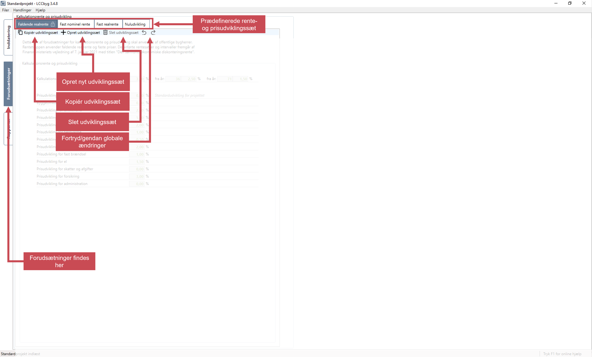
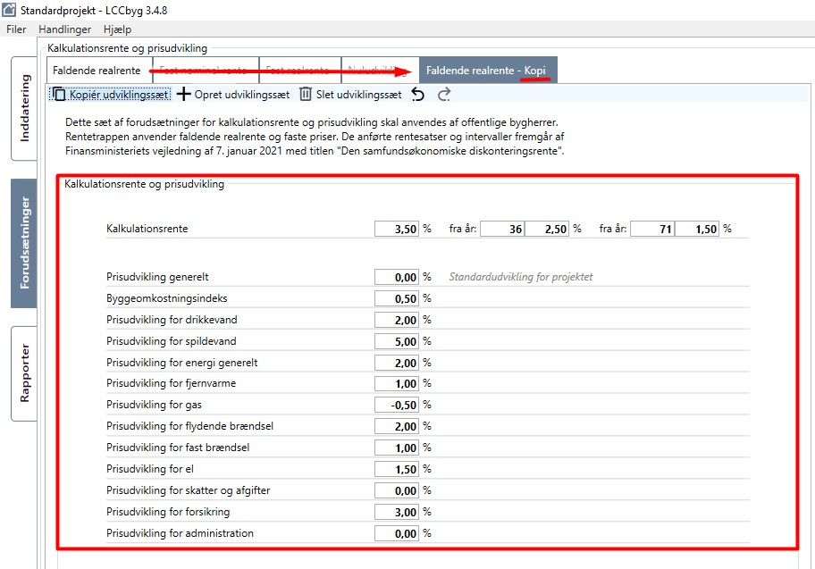

’Forudsætninger’ fastlægger en række generelle beregningsforudsætninger, dvs. kalkulationsrente og prisudvikling for forskellige omkostningsgrupper.

Figur 1 viser brugergrænsefladen for forudsætninger i LCCbyg. Her ses fire prædefinerede rente- og prisudviklingssæt, henholdsvis 'Faldende realrente', 'Fast nominel rente', 'Fast realrente' samt nuludvikling. Derudover ses detaljer for [kalkulationsrente og prisudvikling](#kalkulationsrente) for 'Faldende realrente'. Derudover ses en værktøjslinje under de fire alternativer, der kan bruges til at oprette, kopiere og slette udviklingssæt. Bemærk, at de fire prædefinerede udviklingssæt ikke kan slettes. 

Figur 1:  'Forudsætninger'

### Kalkulationsrente og prisudvikling

LCCbyg giver mulighed for, at brugeren kan arbejde med enten en ensartet eller forskellige kalkulations- eller diskonteringsrenter over tid.

#### Kalkulationsrente

Der er mulighed for at opdele i tre perioder. Værdien i den første boks angiver den anvendte kalkulationsrente fra starttidspunktet for beregningerne. Betegnelsen ’Fra år’ markerer starttidspunktet for brugen af den næste værdi for kalkulationsrenten, og så fremdeles med den sidste periode.

Som udgangspunkt er det ikke muligt at ændre værdier angivet i 'Forudsætninger', hvis du arbejder i en skabelon for standardprojekt eller skabelon for ’Almene boliger med SfB klassifikation, idet disse værdier er låste og dermed beskyttet mod ændring.

_Du kan kopiere det valgte rente- og prisudviklingssæt ved at trykke på 'Kopiér udviklingssæt' i værktøjslinjen. Derefter er det muligt at inddatere i kopien af den pågældende rente og prisudvikling, idet værdierne i kopien ikke længere er låste (se figur 2)._

Figur 2: Kalkulationsrente og prisudvikling

Offentlige bygherrer er forpligtet til at følge en faldende rentetrappe ift. Finansministeriets budgetvejledning med tillæg. Standardindstillingen viser den faldende rentetrappe. Som udgangspunkt er LCCbyg sat op til brug med rentetrappen for offentlige bygherrer, dvs. med en faldende realrente og faste priser. Hvis du vil arbejde med en nominel kalkulationsrente og løbende priser, skal du huske at ændre indstillingen til 'Nominel rente og løbende priser' under de enkelte alternativer under 'Inddatering'.

#### Prisudvikling

Der er to forskellige måder at arbejde med prisudvikling på i LCCbyg: Enten med faste eller løbende priser. Hvis der arbejdes med faste priser, vil beløbet være det samme år efter år. Det vil sige, at et beløb på fx 100 kr. i år 1 også vil optræde som 100 kr. i alle de efterfølgende år. Hvis der arbejdes med løbende priser, vil beløbet ændre sig år for år svarende til prisudviklingen for den pågældende type af omkostninger. Ved en årlig prisudvikling på 2 % vil 100 kr. eksempelvis blive til 102 kr. i år 1, 122 kr. i år 10 og 269 kr. i år 50.

_Brugeren af LCCbyg skal være særlig opmærksom på, om der er typer af omkostninger, som forventes at stige eller falde mere end den gennemsnitlige prisudvikling. Hvis det er tilfældet, kan standardværdierne blot overskrives med egne værdier. Hvis det ikke er tilfældet, kan standardværdierne anvendes. Du skal dog være opmærksom på, at dine egne værdier i så fald fradrages den generelle prisudvikling. Hvis du fx vil anvende en prisudvikling på 6 % på en omkostning, og den generelle prisudvikling er sat til 2 % i applikationen, så skal du skrive 4 % ud for den pågældende omkostning._
