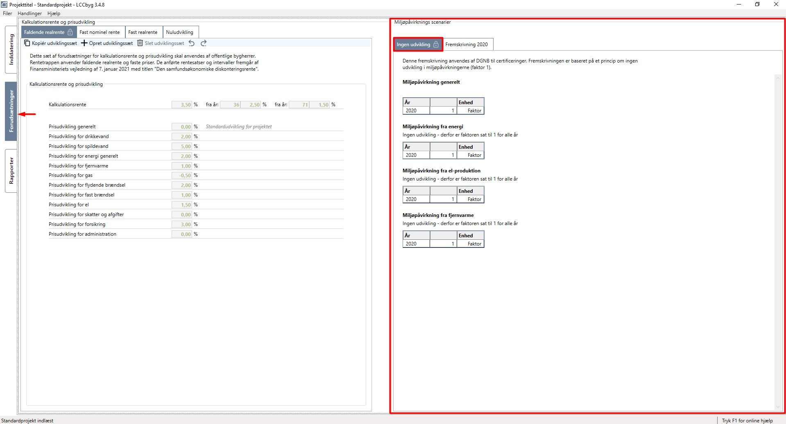
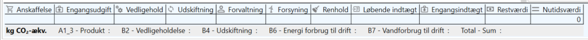

DGNB Byområder beregner foruden levetidsomkostninger også på CO2\-udledninger forbundet med et byområde. Miljøpåvirkningerne (i form af CO2\-udledninger) beregnes via ['Miljøpåvirkningsscenarie'](#miljø) og [nøgletal](#byrum) udviklet til certificering af byområder fra DGNB2020-manualen_._ 

### Miljøpåvirkningsscenarier

I denne skabelon er det muligt at vælge miljøpåvirkningsscenarier på samme vis som for rente- og prisudvikling. I skabelonen er det muligt at vælge mellem to miljøpåvirkningsscenarier:

- Ingen udvikling (det scenarie der anvendes i DGNB).
- Fremskrivning 2020 (denne fremskrivning er baseret på politiske mål om at øge andelen af vedvarende energi i dansk energiforsyning i perioden 2020-2050). Fremskrivningen gælder for el og fjernvarme. Kilde: Trafik-, Bygge, og Boligstyrelsen: Nye emissionsfaktorer for el og fjernvarme 2020.

Miljøpåvirkningsscenarierne findes under fanen 'Forudsætninger' i denne skabelon. Her kan de konkrete værdier for de to nævnte scenarier ses (figur 1).

Figur 1: Miljøpåvirkningsscenarierne i skabelonen DGNB-byområde.

På samme vis som det er muligt at opbygge sit eget sæt af rente- og prisudvikling i LCCbyg, er det her også muligt at opbygge sit eget miljøpåvirkningsscenarie. Dette gøres ved at oprette en kopi af et af de to scenarier og ændre i værdierne herfor til det ønskede scenarie. Der skal dog gøres opmærksom på, at i DGNB-regi opereres der endnu ikke med en udvikling for miljøpåvirkningsscenarier.

### Miljøpåvirkninger

Skabelonen 'DGNB-byrum' indeholder nøgletal for arealer, forsyning og renhold. Nøgletallene er opbygget med udgangspunkt i strukturen i DGNB Byområde Manualen 2020. Kontoplanen kommer med levetider, priser på forsyning og renhold samt CO2\-miljøpåvirkning (GWP) referenceværdier.

Beregninger med værktøjet giver et overslag over de forventede omkostninger og CO2\-miljøpåvirkning (GWP) til gennemførelse af en byudviklingsopgave og den efterfølgende drift heraf over en 50-årig periode samt eventuelle udskiftninger undervejs. Beregningerne bygger på generiske nøgletal, som ikke nødvendigvis er retvisende for den konkrete opgave. Priser er baseret på vejledende overslag fra Molio Prisdata. Forventede levetider er bearbejdet fra [levetidstabellen](https://lccbyg.dk/levetidstabel2021/) i rapporten BUILD2021:32.

Miljøpåvirkningerne stammer fra BMVBS 2012, her er A1-3 Produktfasen opgivet. Denne værdi er på baggrund af en erfaringsbaseret fordelingsnøgle (ses herunder) anvendt til at fastlægge de resterende moduler under areal-rækkerne, nemlig B2 Vedligehold og B4 Udskiftning, som anvendes i denne skabelon. Den erfaringsbaserede fordelingsnøgle er bestemt ud fra SBi 2020:04.

- A1-3 Produkt: Svarende til 50 % af den samlede udledning.
- B2 Vedligeholdelse: Svarende til 10 % af A1-3 Produktfasen.
- B4 Udskiftning: Svarende til A1-3 adderet med C3/C4.
- B6 Forsyning: Svarende til 25 % af A1-3 Produktfasen – dette indtaster man dog separat på samme måde som Renhold.
- C3/C4 Bortskaffelse: Svarende til 15 % af A1-3 Produktfasen (Modulerne vedrørende bortskaffelse er ikke en del af DGNB Byområde).

Usikkerheden på resultaterne afhænger af de anvendte beregningsforudsætninger og data til beregningerne. Ændringer af disse kan have stor betydning for resultaterne. Ved mere komplekse byggeopgaver eller behov for mere retvisende beregninger bør en rådgiver konsulteres og følsomhedsanalyser gennemføres.

Resultaterne for det pågældende alternativ vises nederst i LCCbyg. Det giver mulighed for en umiddelbar sammenligning af resultater på tværs af alternativerne inden for det pågældende projekt. De detaljerede resultater omfatter følgende posteringstyper og CO2\-udledninger for de respektive faser i kontoplanen. Se ['Posteringer'](https://lccbyg.dk/help/34/docs/interface/results/) for nærmere beskrivelse af [posteringstyper](https://lccbyg.dk/help/34/docs/interface/results/). 

Figur 2: Resultatfeltet i DGNB byområde.
