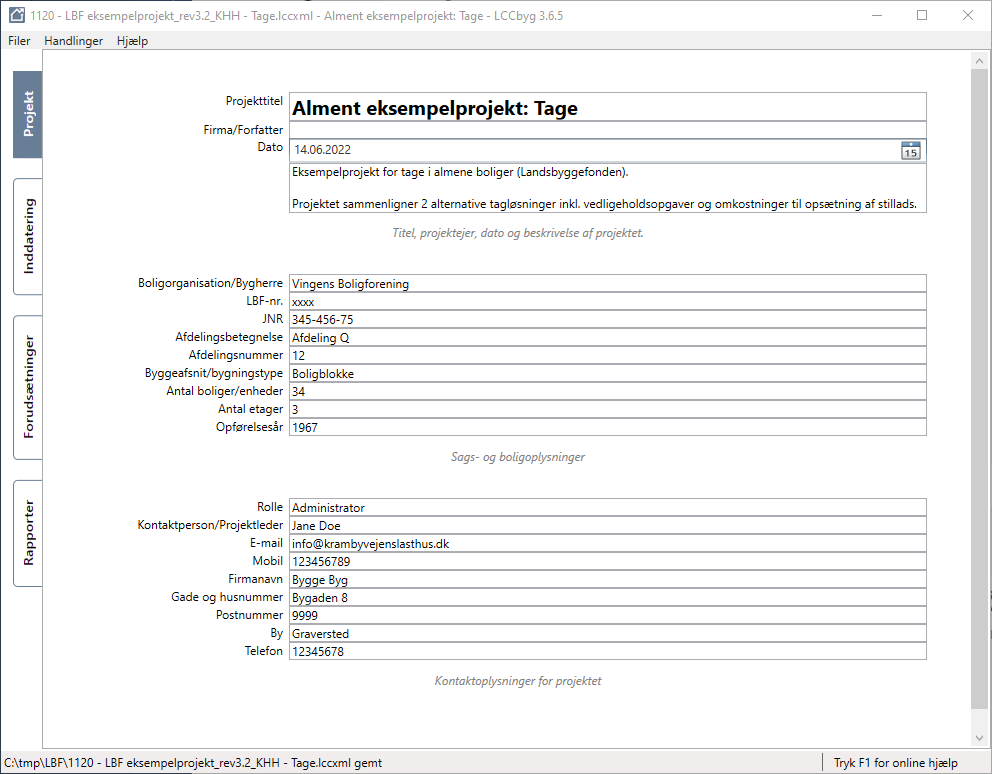

Under fanen "Projekt" finder du muligheder for at inddatere projekttitel, dato og stamoplysninger for hele projektet.

<figure  markdown="1">

<figcaption markdown="1">
Projektdatafanen
</figcaption>
</figure>

Oplysningerne fra projektfanane kan også indsættes i dine rapporter. 
Læs mere om det i [Rapporter](../Reports/)

<figure  markdown="1">

<figcaption markdown="1">
Oplysningerne fra projektfanen indsat i en rapport.
</figcaption>
</figure>
 

