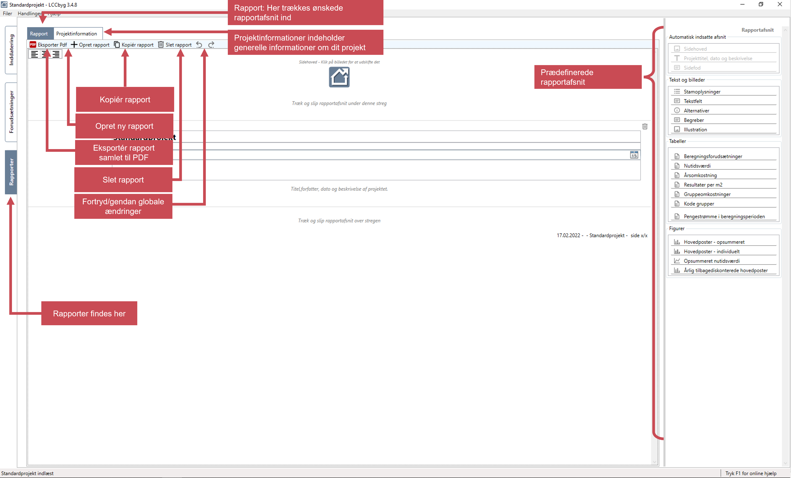
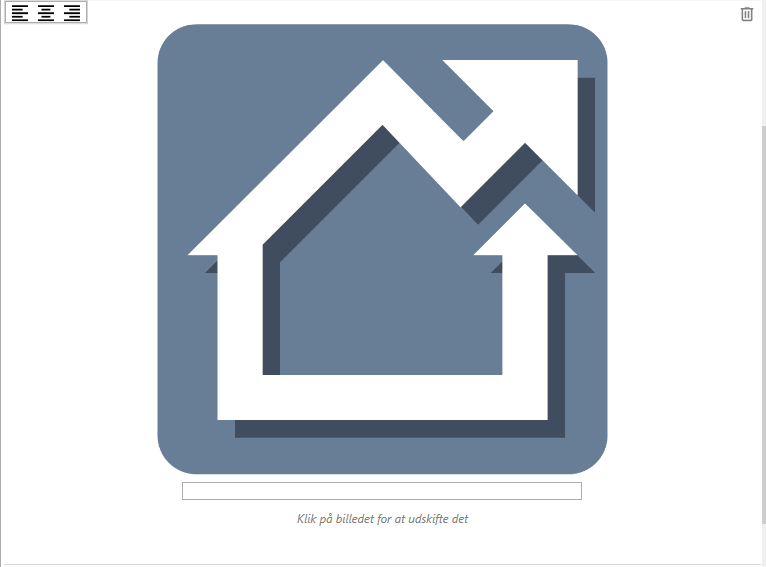
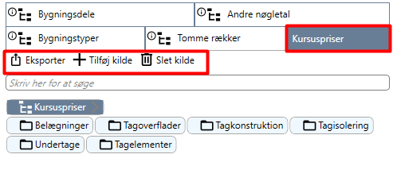
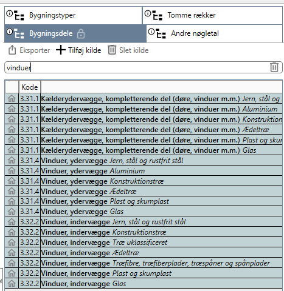
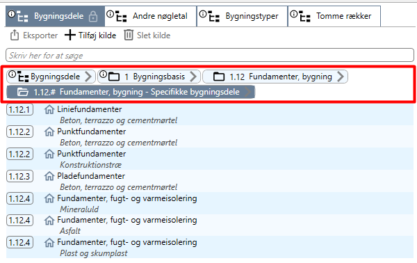
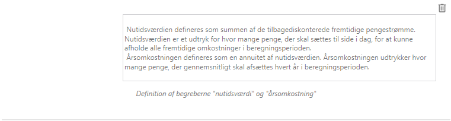
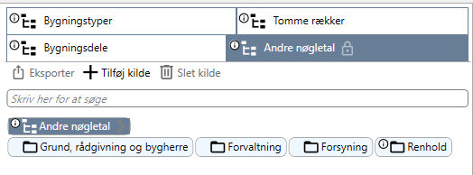
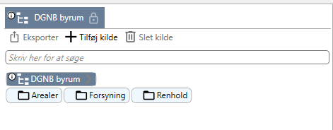
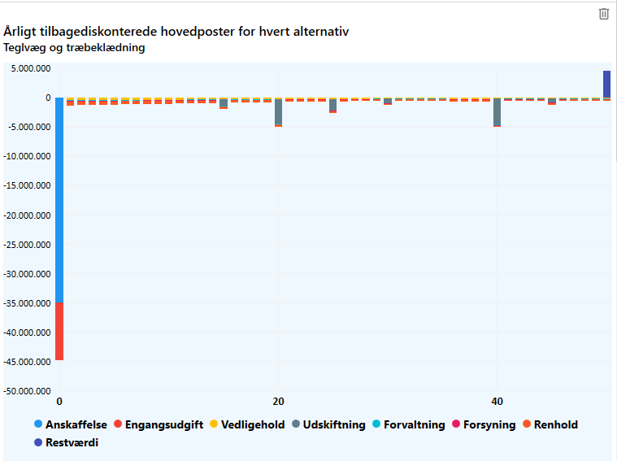

Beregningsresultaterne kan ses under ’Rapport’. Her findes en række prædefinerede rapportafsnit, der kan indtrækkes i rapporten. Du har således mulighed for at sammensætte og tilpasse rapporten efter dit behov. Rapporten står af to rapportdele, nemlig 'Rapport' og 'Rapportinformation'.

Figur 1: Oversigt over rapportafsnit. 

'Rapport' betragtes som hovedrapporten, som bl.a. kan bruges til at en fil i pdf-format med tekst, grafer og tabeller, resultater og beskrivelser fra projektet. Dette gøres via 'Eksporter PDF' i værktøjslinjen. Rapporter får automatisk indsat sidehoved og sidefod samt et afsnit med projekttitel, dato, forfatter/firmanavn og beskrivelse. Disse felter bliver benyttet i LCCbygs titellinje og i rapporternes sidefod.

Flere skabeloner har en ekstra rapport kaldet 'Projektinformation'. Den er et eksempel på, hvordan stamoplysninger, og noter kan gemmes i en selvstændig rapport til internt brug.

Under [rapportafsnit](#rapportafsnit) vælger du hvilke afsnit, du ønsker at medtage i den endelige rapport. De tilgængelige rapportafsnit ses i højre side af skærmbilledet. Du kan vælge en lang række rapportafsnit som fx 'Illustration', 'Stamoplysninger', 'Alternativer', 'Hovedomkostningsgrupper', 'Opsummerede nutidsværdier' osv.

Når du er tilfreds med rapporten, kan du gemme som projekt fil eller pdf [(se mere under 'Eksport af rapport')](https://lccbyg.dk/help/31/docs/interface/reports/export/).

### Rapportafsnit

'Rapportafsnit' er en liste over afsnit med tekst, grafer og tabeller, du kan trække ind i din rapport. Placeringen af de tilgængelige rapportafsnit er market på figur 1 nedenfor. Figur 1 viser  de typiske rapportafsnit, men bemærk, at disse kan variere fra skabelon til skabelon. 

Du kan medtage rapportafsnit ved at trække dem over i rapporten i venstre side. Du kan frit vælge, hvor du vil placere det pågældende afsnit ved at trække det op/ned i venstre side.

- Du kan fjerne et afsnit ved at trykke på det grå ikon for skraldespand øverst til højre i hvert afsnit. 
- Du kan ændre rækkefølgen på rapportafsnit i rapporten ved at trække og slippe dem. 
- Du kan farvelægge tabelafsnit efter de er indsat. Det gøres med farvepaletten i afsnittets øverste venstre hjørne.
- Du kan eksportere tabelafsnit til regneark - se eksport af [rapport og rapportafsnit](https://lccbyg.dk/help/34/docs/interface/reports/export/).

### Sammensætning af rapporten

Som standard er der en række afsnit indsat på forhånd i rapporten, men disse kan du ændre, så det passer til dine behov. Som udgangspunkt er følgende afsnit sat til at komme med i rapporten:

- 'Sidehoved
- 'Projekttitel, dato og beskrivelse'
- 'Sidefod'

Figur 2: Automatisk indsatte rapportafsnit.  
  
Derudover indeholder LCCbyg en række prædefinerede rapportafsnit. Disse er sorteret i tre grupper; hhv. 'Tekst og billeder', 'Tabeller' og 'Figurer.   
  

#### Tekst og billeder

**Rapportafsnit**

**Visning i LCCbyg**

**Stamoplysninger**

Her kan du uddybe informationerne omkring dit projekt og bl.a. angive hvem den ansvarlige for projektet er.

[

**Tekstfelt**

Tekstfelter kan indsættes ubegrænset i rapporten. De kan bl.a. bruges til at beskrive tabeller og figurer i rapporten.

[

**Alternativer**

Alternativer indsætter ’detaljer for alternativ’ for hvert alternativ i projektet. Du kan således sammenligne to eller flere alternativers detaljer i form af rente- og prisudviklingssæt, bruttoarealer samt beskrivelser.

For flere informationer, se afsnit 6 Alternativer.

[

**Begreber**

Dette rapportafsnit beskriver de væsentligste begreber, der indgår i beregningen. Tekstfeltet er låst og kan ikke redigeres.

[

**Illustration**

Illustrationer kan indsættes via dette rapportafsnit. Derved kan renderinger eller faktiske billeder af projektet indsættes. Det kan også være plantegninger eller lignende. Der kan indsættes flere illustrationer i rapporten.

[

#### Tabeller

**Rapportafsnit**

**Visning i LCCbyg**

**Beregningsforudsætninger**

Tabellen beskriver beregningsforudsætningerne for projektets alternativer.

[

**Nutidsværdi**

Nutidsværdien defineres som summen af de tilbagediskonterede fremtidige pengestrømme. Nutidsværdien er et udtryk for, hvor mange penge, der skal sættes til side i dag for at kunne afholde alle fremtidige omkostninger i beregningsperioden.

Afsnittet 'Nutidsværdier' opsummerer de vigtigste beregninger i tabelform. Tabellen giver en oversigt over fordelingen af omkostningerne på hovedomkostningsgrupper. Anskaffelse angiver summen af omkostningerne forbundet med anskaffelsen i ’År 0’. De øvrige hovedomkostningsgrupper omfatter driftsomkostningerne over tid.

**Årsomkostning**

Tabellen viser de årlige omkostninger forbundet med hver af projektfilens alternativer. Der skelnes imellem årsomkostninger med og uden restværdi.

**Resultater per m2**

Tabellen indeholder nutidsværdi og årsomkostning opgjort per kvadratmeter for hvert af projektets alternativer. Der skelnes imellem nutidsværdier og årsomkostninger med og uden restværdier. Til beregningen benyttes bruttoarealet inddateret under ’detaljer for alternativ’ (se afsnit 6 Alternativer)

**Gruppeomkostninger**

'Gruppeomkostninger' for hvert alternativ vises i tabelform og opsummerer omkostningerne forbundet med de forskellige hovedomkostningsgrupper.

**Kodegrupper**

Dette rapportafsnit indsætter en tabel per alternativ i projektet. Hver af tabellerne gennemgår de respektive alternativers fordeling af nutidsværdier fordelt på hovedposter og SfB-hovedgrupper.

**Pengestrømme i beregningsperioden**

Dette rapportafsnit resulterer i en tabel per alternativ i projektet. Hver af tabellerne indeholder de årlige pengestrømme i beregningerne for hvert alternativ fordelt på hovedposterne. Derved synliggøres det bl.a. i hvilke år, der falder en ekstra omkostning grundet udskiftning af bygningsdele.

### Figurer

**Rapportafsnit**

**Visning i LCCbyg**

**Hovedposter – opsummeret**

Dette rapportafsnit opsummerer alternativernes hovedposter grafisk.

Du kan fremvise værdierne i listeform ved at holde cursoren over en vilkårlig farve på grafen.

**Hovedposter – individuelt**

Dette rapportafsnit viser alternativernes hovedposter individuelt.

Du kan fremvise værdierne i listeform ved at holde cursoren over en vilkårlig farve på grafen.

**Opsummeret nutidsværdi**           

'Opsummeret nutidsværdi' viser de årlige nutidsværdier for de valgte alternativer i hele beregningsperiode. Værdierne for de forskellige alternativer vises som graf, hvor y-aksen viser omkostning, mens x-aksen viser årstal (den angivne beregningsperiode). For at fremvise nutidsværdien i et bestemt årstal, skal du holde cursoren over årstallet, hvorefter der dukker en tekstboks op, som viser værdier for de valgte alternativer i det pågældende år (årstal vises med sort-fed skrift).

**Årlig tilbagediskonterede hovedposter**

Årsomkostning defineres som en annuitet af nutidsværdien. Årsomkostning udtrykker hvor mange penge, der gennemsnitligt skal afsættes hvert år i beregningsperioden. Af grafen fremgår restværdien for hvert år i hele beregningsperiode. Der indsættes en graf per alternativ.

