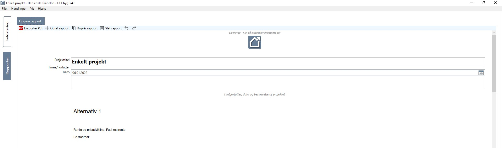

Rapporten sammenfatter resultaterne fra den totaløkonomiske beregning på baggrund af det inddaterede. Hvis du har oprettet flere alternativer i beregningen, gør rapporten det også muligt at sammenligne resultaterne på tværs af alternativer.

Den enkle skabelon vises som udgangspunkt i en enkel brugergrænseflade. Her er de centrale rapportafsnit er valgt for dig, og der ikke er mulighed for at tilføje og fjerne dem. De valgte afsnit er følgende:

- Alternativer
- Opsummeret nutidsværdi (uden restværdi).
- Hovedposter fordelt efter kodegrupper.
- Årsomkostninger for hvert alternativ opgjort som annuitet per år.
- Årligt tilbagediskonterede hovedposter for hvert alternativ.
- Hovedposter og nutidsværdi for hvert alternativ.
- Beregningsforudsætninger for hvert alternativ.

Figur 1: Her ses skærmbilledet for rapporter vist i 'Enkel grænseflade' 

Hvis du ønsker at tilpasse hvad din rapport indeholder, kan du skifte til den almindelige brugergrænseflade (Se hvordan under [Hovedmenulinjen - Vis](https://lccbyg.dk/help/34/docs/interface/help/)). Dine muligheder for at opbygge din egen rapport i almindelig brugergrænseflade er beskrevet under ['Rapporter'](https://lccbyg.dk/help/34/docs/interface/reports/).

Du kan udtrække hele rapporten som pdf, eller tabeller til regneark, via [eksport af rapport og rapportafsnit](https://lccbyg.dk/help/34/docs/interface/reports/export/).
