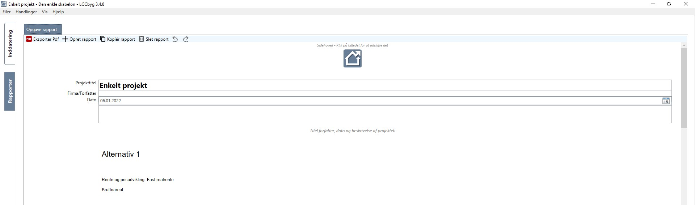

Ved 'Enkel grænseflade' er de nødvendige rapport afsnit valgt for dig. De valgte afsnit er følgende:

- Alternativer
- Opsummeret nutidsværdi (uden restværdi)
- Hovedposter fordelt efter kodegrupper
- Årsomkostninger for hvert alternativ opgjort som annuitet per år
- Årligt tilbagediskonterede hovedposter for hvert alternativ
- Hovedposter og nutidsværdi for hvert alternativ
- Beregningsforudsætninger for hvert alternativ

Figur 1: Her ses skærmbilledet for rapporter vist i 'Enkel grænseflade'

 

Når du er tilfreds med rapporten, kan du gemme som projekt fil eller pdf [(se mere under 'Eksport af rapport')](https://lccbyg.dk/help/31/docs/interface/reports/export/).
