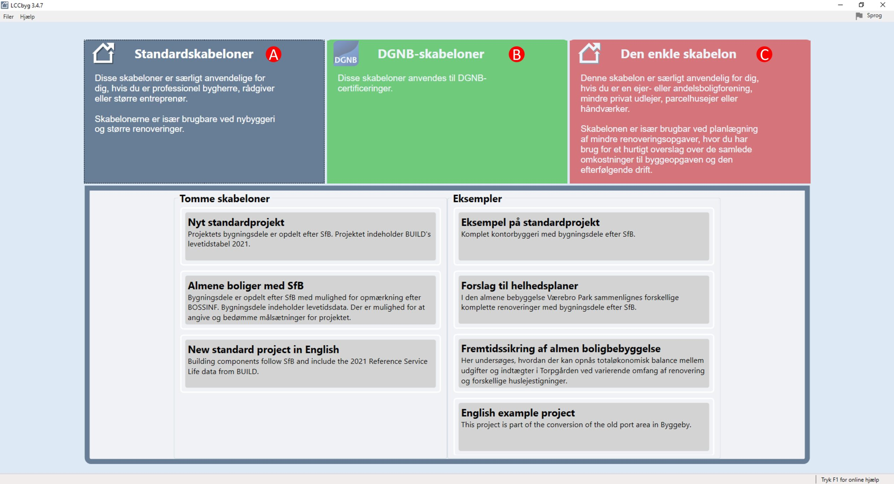
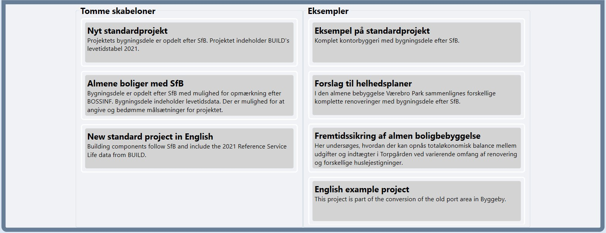
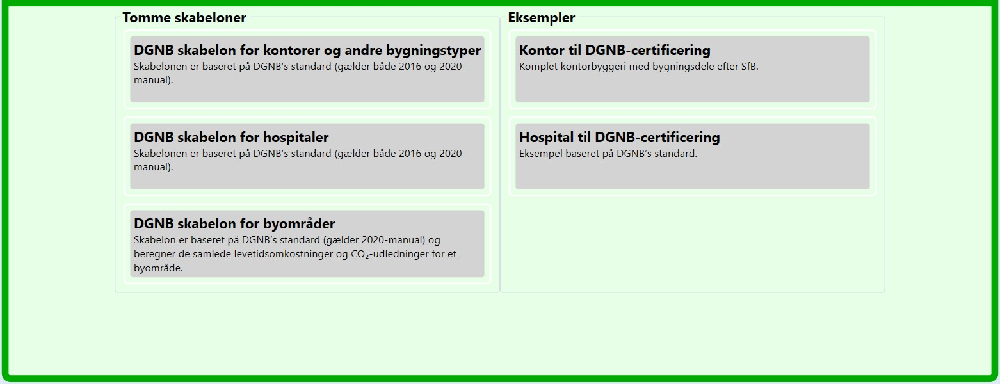
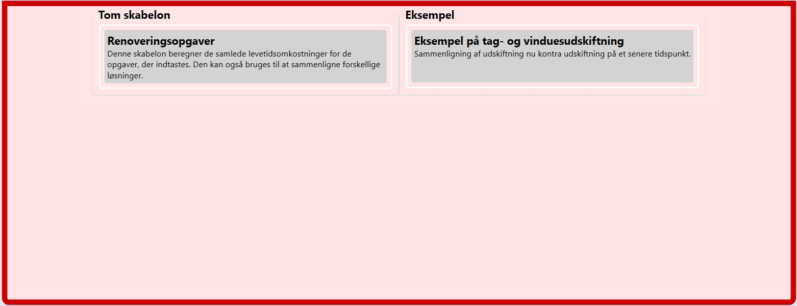

Dette er brugervejledningen til LCCbyg version 3.4, som er et digitalt værktøj, der kan bru-ges til totaløkonomiske beregninger. Brugervejledningen gennemgår de punkter, du bør være opmærksom på forud for en beregning og de forskellige trin i beregningen.

 
LCCbyg-beregninger består overordnet af følgende trin:

1. Åben en projektskabelon.
2. Valg af rækker og inddatering af mænger og priser.
3. Evt. tilpasning af beregningsforudsætningerne
4. Vurdering, sammenstilling af resultater.
5. Gem rapport som Pdf.

### Projektskabeloner - Vælg beregningstype blandt flere forskellige skabeloner

LCCbyg indeholder en række projektskabeloner. Der findes overordnet set tre forskellige skabelontyper. På startsiden kan du vælge den skabelon, der er mest relevant for dit projekt. Under hver skabelontype findes én eller flere skabeloner samt ét eller flere eksempelprojekter. For nærmere information omkring eksempelprojekterne, se LCCbyg.dk. På figur 1 kan skabelonerne under 'Standardskabeloner' ses.

Er du privatperson eller ny inden for totaløkonomiske beregninger, vil 'Den enkle skabelon' mæske være at foretrække for dig. Er du derimod fagprofessionel, vil skabeloner under 'Standardskabeloner' og 'DGNB-skabelonerære at foretrække for dig.

<figure markdown="1">

 
<figcaption>
Startside LCCbyg 3.4 - Vælg den relevante skabelon blandt Standardskabeloner, DGNB-skabeloner og Den enkle skabelon.
</figcaption>
</figure>

- [A. Standardskabeloner](#standardskabeloner)
- [B. DGNB-skabeloner](#DGNB)
- [C. Den enkle skabelon](#alle)

#### Standardskabeloner

Her kan der vælges mellem skabeloner og eksempelprojekter.

<figure markdown="1">

<figcaption>
Startside LCCbyg - Vælg den relevante skabelon blandt Standardskabeloner, DGNB-skabeloner og Den enkle skabelon.
</figcaption>
</figure>

'Nyt standardprojekt' er LCCbygs standard skabelon. Den indeholder BUILDs [Levetidstabel](https://lccbyg.dk/levetidstabel2021/) og bygningsdele opdelt efter SfB. En engelsk version af denne skabelon findes under 'New standard project in English'.

'Almene boliger med SfB' er en udvidet version af standardprojektet, hvor bygningsdele er opdelt efter SfB med mulighed for opmærkning efter BOSSINF. Derudover er det muligt at angive og bedømme målsætninger for projektet.

##### Standardprojekt eksempler

'Eksempel på standardprojekt' indeholder et komplet kontorbyggeri efter SfB ved brug af 'Standardprojekt'-skabelonen. 'English example project' indeholder samme eksempelprojekt på engelsk.

'Forslag til helhedsplaner' sammenligner komplette renoveringer af en almen bebyggelse ved brug af skabelonen for 'Almene boliger med SfB'.

'Fremtidssikring af almen boligbebyggelse' benytter 'Almene boliger med SfB' til at undersøge hvordan totaløkonomi i en almen boligbebyggelses balanceres ved variende omfang af renovering.

Yderligere eksempler findes i <a href="https://lccbyg.dk/lccipraksis/lcceksempler/" target="_blank">Eksempelsamlingen på Lccbyg.dk.</a>

#### DGNB-skabeloner

Disse skabeloner er skræddersyede til DGNB-certificeringer. De indeholder alle levetider og enhedspriser for forsyning.

<figure markdown="1">

<figcaption>DGNB-skabeloner - de tomme skabeloner ses til venstre, og eksemplerne ses til højre.
</figcaption>
</figure>
 

'DGNB skabelon for kontorer og andre bygningstyper' er baseret på DGNBs standard. Den følger således både 2016 og 2020-manualerne.

'DGNB skabelon for hospitaler' er baseret på DGNBs standard for hospitalsbyggerier.

'DGNB skabelon for byområde' er baseret på DGNBs 2020-manual. Skabelonen benyttes til at beregne de samlede levetidsomkostninger og miljøpåvirkninger for et byområde.

#### Den enkle skabelon

Den enkle skabelon er målrettet den ikke-professionelle bruger, og er særlig anvendelig for dig hvis du er en ejer- eller andelsboligforening, mindre privat udlejer, parcelhusejer eller håndværker. Skabelonen er især brugbar ved planlægning af mindre renoveringsopgaver, hvor du har brug for et hurtigt overslag over de samlede omkostninger til byggeoppgaven og den efterfølgende drift.

<figure markdown="1">

<figcaption>
Den enkle skabelon - den tomme skabelon ses til venstre, eksemplet ses til højre.
</figcaption>
</figure>
  

Disse skabeloner indeholder detaljer vedrørende typisk vedligehold, enhedspriser samt levetid mm. Som bruger skal du blot indtaste dine mængder.
