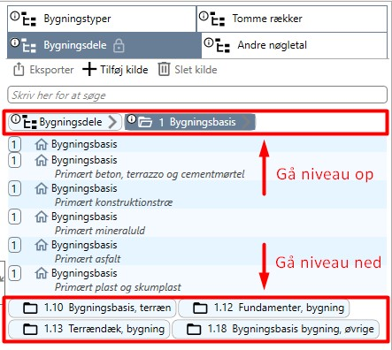
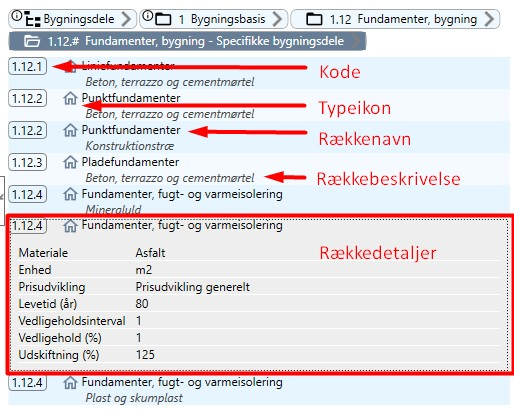
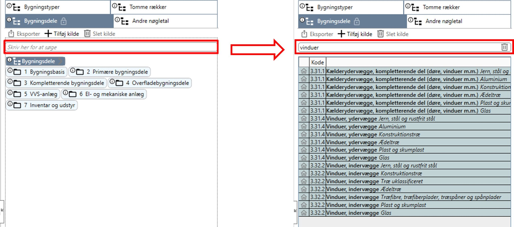

 Følgende afsnit beskriver de tilgængelige nøgletal i LCCbyg, introducerer [navigationsprincippet](#navigation) i nøgletal, herunder beskrivelse af [søgefunktionen](#søgefunktion), og beskriver muligheden for [at importere og eksportere egne nøgletal](#importeksport). Nøgletallene findes i programmets højre side, når fanen inddatering er åben (se figur 1).

 <figure markdown="1">
 

<figcaption markdown="1">
Biblioteket
</figcaption>
</figure>

Alle skabeloner kommer med en eller flere faner med nøgletal. Du skal bruge nøgletalene til at sammensætte og tilpasse dine beregninger til det aktuelle behov. LCCbyg består på tværs af skabeloner af følgende faner med nøgletal:

- [Tomme rækker](#tommerækker) findes i alle skabeloner, undtagen DGNB Byrum og den enkle skabelon. Tomme rækker kan benyttes, når skabelonens andre nøgletal ikke passer på dit projekt.
- [Bygningsdele](#bygningsdele) findes i alle standardskabeloner. Bygningsdelene er baseret på BUILD's [levetidstabel](https://lccbyg.dk/levetidstabel2021/) og klassificeret efter SfB-systemet.
- [Andre nøgletal](#andrenøgletal) findes i alle standardskabelonerne. [Andre nøgletal](#andrenøgletal) indeholder nøgletal for grund, rådgivning, bygherreomkostninger, forvaltning, forsyning og renhold.
- [Bygningstyper](#bygningstyper) findes i alle standardskabelonerne. Nøgletallene kan anvendes til indledende planlægning af byggeprojekter eller byplanlægning.
- [Nøgletal - SfB](#bossinf) benyttes i DGNB skabelonen til kontorer og andre bygningstyper samt DGNB hospital. Nøgletallene er baseret på DGNB-manualerne.
- [Målsætninger](https://lccbyg.dk/help/34/docs/interface/groupeddataentry-almeneboliger/) findes i skabelonen til [Almene boliger med SfB.](https://lccbyg.dk/help/34/docs/interface/groupeddataentry-almeneboliger/) Målsætninger indeholder kriterier der kan opstilles til vurdering af hvert alternativ.
- [DGNB byrum](https://lccbyg.dk/help/34/docs/interface/groupeddataentry-dgnb-by/) benyttes i DGNB Byområder skabelonen. Nøgletallene er baseret på DGNB 2020-manualen og benyttes til at beregne totaløkonomi og CO2\-udledninger for et byområde.
- [Opgaver](https://lccbyg.dk/help/34/docs/interface/den-enkle-skabelon/groupeddataentry-lite/) benyttes i den enkle skabelon, der benyttes til simple totaløkonomiske beregninger.

### Navigation i kontoplaner

Navigationsprincippet er fælles for alle nøgletalsfaner. I det følgende forklares princippet for navigation på baggrund af fanen indeholdende [bygningsdele](#bygningsdele) (se [bygningsdele](#bygningsdele) for nærmere beskrivelse af hvad disse nøgletal indeholder). Der findes grundlæggende mapper og rækker i nøgletalsvisningen.

Figur 2 viser fanen, når den åbnes i LCCbyg. I bygningsdele findes 7 hovedmapper. Hvis du trykker på mapperne, kan du se hvad de indeholder. Den røde firkant markerer hovedmappen for nøgletallene i fanen. Den kan du altid trykke på for at komme tilbage til udgangspunktet.

<figure markdown="1">
 
<figcaption markdown="1">
Figur 2: Eksempel på mappestruktur i fanen med nøgletal vedrørende bygningsdele.
</figcaption>
</figure>

Figur 3 viser mappestrukturen et niveau dybere nede i hierarkiet. Den røde firkant i toppen af billedet viser stien for den åbne mappe, og du kan altid bruge denne til at navigere imellem mapper på overliggende niveauer. Den nederste røde firkant viser, at der er yderligere rækker og undergrupper. Du kan trykke på mapperne for at se, hvad de indeholder.
<figure markdown="1">

<figcaption markdown="1">
Figur 3: Brug mapperne _over_ rækkerne til at gå et eller flere mappeniveauer op. Brug mapperne _under_ rækkerne til at gå et niveau ned.
</figcaption>
</figure>

Der er med andre ord et generelt princip, hvor mapper, der vises over rækkerne, kan bruges til at gå en eller flere led op i en mappestruktur, imens mapper under rækkerne kan bruges til at gå et niveau ned ad gangen. Hvis ikke der er flere mapper under rækkerne, er der ikke yderligere undergrupperinger af nøgletallene. Figur 4 viser, hvordan stien for placeringen kan vokse. Bemærk at den aktive mappe er markeret med mørkeblå. Figur 4 viser ydermere forskellige detaljer, der generelt kan læses ud af rækker under nøgletal. For nærmere beskrivelse af rækketype og detaljer - se [rækketyper.](https://lccbyg.dk/help/34/docs/interface/costtypes/)

<figure markdown="1">

<figcaption markdown="1">
Figur 4: Brug stien til at gå en eller flere mapper op.
</figcaption>
</figure>
 

#### Søgefunktion

Hvis ikke du ved hvor en specifik række befinder sig, kan det være nyttigt at bruge søgefunktionen. Under fanerne med nøgletal kan du foretage en søgning efter rækker. Søgningen sker inden for den valgte fane. Hvis rækkerne har koder, kan du også søge efter dem. Du kan trække den relevante række direkte fra søgeresultatet og sætte den ind i den ønskede gruppe. Søgning afsluttes ved at trykke på den grå papirkurv i søgefeltet.
<figure markdown="1">

<figcaption markdown="1">
Figur 5: Søg efter rækker ved hjælp af søgefunktionen og indsæt direkte i inddateringen.
</figcaption>
</figure>
