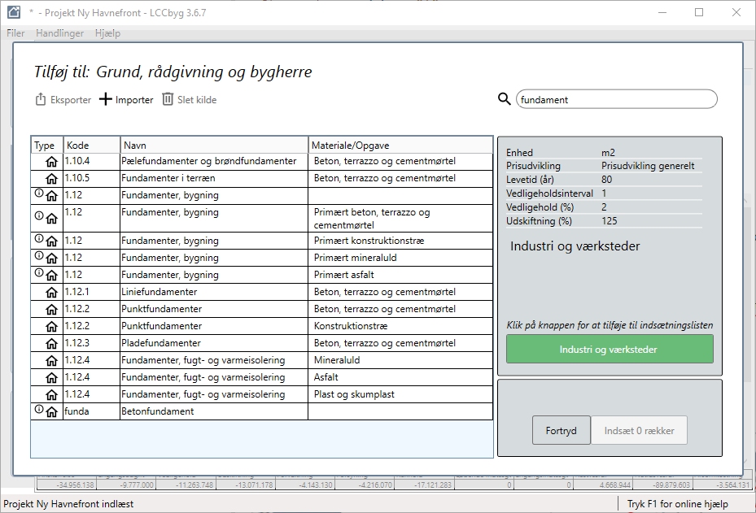

I LCCBygs bibliotek findes kontoplaner der kan anvendes til at opbygge din beregning. Kontoplanerne indeholder forskellige rækketyper med nøgletal.

Det er ikke alle rækker der indeholder priser, men alle rækker har vedligeholds- og genopretningsprocenter. Nogel kontoplaner har også værdier for Global Warming Potential, angivet som kg SO2-Equiv./m³

Nogle kontoplaner har rækker på et højt abstraktionsniveau, altså det vi kalder sammensatte bygningsdele.

 <figure markdown="1">
 

<figcaption markdown="1">
Biblioteket
</figcaption>
</figure>

 Du kan læse om de forskellige rækketyper her: [Rækketyper i LCCByg](../General/rowtypes)
 
 
 

### Navigation i biblioteket

<figure markdown="1">
<iframe width="560" height="315" src="https://www.youtube.com/embed/qYrX4Afdh7M" title="YouTube video player" frameborder="0" allow="accelerometer; autoplay; clipboard-write; encrypted-media; gyroscope; picture-in-picture" allowfullscreen></iframe><figcaption markdown="1">
En videointroduktion til Biblioteket
</figcaption>
</figure>

#### Søgefunktionen

Husk at hvis ikke du ved hvor en specifik række findes, kan du søge på tværs af alle kontoplanerne. Du kan både søge på tekst og på koder.

For at komme tilbage til fanevisningen, skal du slette søgeteksten.

<figure markdown="1">
[]
<figcaption markdown="1">
Søg efter rækker ved hjælp af søgefunktionen og tilføj til indsætningslisten.
</figcaption>
</figure>
